# Introducción {#sec-intro}

La llegada del Partido Republicano (PRCh) a la Cámara no partió a la derecha chilena en dos. La dejó con dos polos dentro del mismo bloque, que coinciden en lo que votan y se separan en cómo enfrentan al Ejecutivo. Este artículo llega a esa conclusión en tres pasos, y cada uno responde una pregunta distinta.

El primero pregunta si la izquierda y la derecha se diferencian y, dado que sí, cuán cohesionadas están las derechas. En B-Call, entre 2016 y 2026, ningún diputado de derecha queda a la izquierda de un diputado de izquierda, y la distancia entre los dos bloques nunca baja de 7,6 desviaciones estándar (@fig-separacion). La mayoría de cada lado vota distinto en el 46% de las votaciones de 2016-17 y en el 86% de las de 2025-26. Dentro de la derecha, cada partido vota muy unido: el índice de Rice del PRCh está entre 0,99 y 1,00, y el de la UDI y RN entre 0,86 y 0,96 (@fig-cohesion-dentro). Lo que cae es la cohesión de la derecha tomada en conjunto. La distancia entre el Rice promedio de sus partidos y el Rice de la derecha completa es casi cero en 2016-17, de 0,03 a 0,05 con Evópoli en 2018-22, y de 0,07 a 0,12 desde que entra el PRCh (@fig-cohesion-entre). La división nueva está entre partidos, no dentro de ellos.

El segundo pregunta si el PRCh ordenó o desordenó ese espacio. Desordenó las etiquetas: los cambios de grupo que tocan a la derecha pasan de entre 0 y 3 por año a entre 4 y 10, y casi todos giran en torno a la propia nueva derecha, con republicanos que pasan a votar como independientes y terminan en el Partido Nacional Libertario (PNL) (@fig-cambios). Y ordenó el voto. La dispersión interna de la UDI y RN, que llega a 0,37 y 0,44 en 2021-22, cae a entre 0,05 y 0,10 desde 2022-23, y la parte de la variación de posición dentro de la derecha que explica el grupo sube de 15% a 63% (@fig-orden). La UDI está en 2,16 desviaciones de la izquierda en 2016-17 y en 2,15 en 2025-26: el PRCh no la arrastró. Quienes sí se movieron hacia la derecha están en el centro, con Demócratas, y entre los independientes, que votan con la derecha más del 90% de las veces (@fig-atraccion).

El tercero pregunta qué movió a las derechas. Un termómetro mercado-Estado, codificado con un modelo de lenguaje, muestra que bajo Piñera la derecha votaba casi igual los textos que ampliaban el Estado y los que lo achicaban, y que bajo Boric empezó a votar según ese eje (@fig-respuesta). Ante textos de más mercado, todas las derechas votan Sí entre 81% y 88% de las veces. Ante textos de más Estado se separan: el PRCh vota Sí el 36% de las veces y la UDI y RN el 49% y el 53%. La división es más probable cuando el texto viene del Ejecutivo: la mayoría del PRCh y la de la derecha tradicional votan distinto en el 22% de las indicaciones del Ejecutivo y en el 6% de las de diputados (@fig-divide). En el libro de códigos de cinco ejes, un texto pro-mercado sube en 4 puntos el Sí de las dos derechas y uno conservador sube 43 el del PRCh y 19 el de la derecha tradicional, una brecha que descansa en pocas votaciones (@tbl-si). En el presupuesto, el No del PRCh pasa de 33% en 2023 a 67% en 2025, y la UDI lo sigue a medias (@tbl-presupuesto).

En la Cámara de Diputados de Chile, la división entre izquierda y derecha es la que más ordena el voto. Desde el plebiscito de 1988, la competencia partidaria se organizó en dos bloques (Tironi y Agüero, 1999; Torcal y Mainwaring, 2003), y en las votaciones nominales la coalición pesó más que el partido (Alemán y Saiegh, 2007). Lo que cambió es la derecha. En la elección de consejeros constitucionales del 7 de mayo de 2023, el PRCh obtuvo 35,5% de los votos y Chile Vamos (ChV), la coalición de la derecha convencional, 21%. En diciembre de 2025, José Antonio Kast ganó la elección presidencial y asumió el 11 de marzo de 2026, un día después del cierre de nuestros datos.^[Falta citar los resultados oficiales del Servel. El argumento no descansa en este hecho: los datos terminan antes del nuevo gobierno.] El ascenso de la derecha radical obliga a preguntar cómo responde la convencional.

El problema tiene dos niveles. El primero es conocido: la izquierda y la derecha se diferencian, y esa diferencia sirve de vara. El segundo es el que este artículo mide: cuánto se diferencian las derechas entre sí con esa vara, si esa diferencia está dentro de los partidos o entre ellos, si la entrada del PRCh ordenó o desordenó el bloque, y en qué contenido y frente a quién se abre.

El vacío de la literatura es anterior a esa medición. Los trabajos sobre cómo responde la derecha convencional al ascenso de la radical miran lo que los partidos dicen, sobre todo en sus programas (Meguid, 2008; Abou-Chadi y Krause, 2020; Krause et al., 2023). Un programa puede moderarse mientras el voto muestra otra cosa. Los estudios que sí miran el voto parlamentario miden cuánto coinciden o se enfrentan los partidos (Santos et al., 2025), y se detienen antes de preguntar qué implicaba cada voto. Sin esa pieza, un Sí compartido puede ser contenido compartido o una misma posición frente al gobierno, las dos lógicas que el voto nominal mezcla (Hix y Noury, 2016). El caso chileno deja el vacío más a la vista: la derecha radical es una escisión de la convencional, y se ha anticipado que esa cercanía facilita la cooperación (Díaz et al., 2023) sin examinarla en el comportamiento legislativo.

El artículo llena ese vacío en tres planos. En lo conceptual, separa la diferencia entre bloques de la diferencia dentro del bloque, y dentro de esta, la cohesión de cada partido de la cohesión entre partidos, el orden del voto del orden de las etiquetas y el contenido de la táctica. En lo empírico, lleva la pregunta del programa al voto en una escisión de la propia derecha. En lo metodológico, combina B-Call, que mide posición y cohesión al mismo tiempo (Toro-Maureira et al., 2025), con dos codificaciones de texto hechas por un modelo de lenguaje y validadas contra un segundo modelo, y con un diccionario de tópicos que describe la agenda.

@sec-teoria presenta la teoría y @sec-hipotesis las hipótesis. @sec-datos describe los datos, las medidas y sus fórmulas. Los resultados van en tres secciones: la división y la cohesión (@sec-bloque1), el orden y el desorden (@sec-bloque2) y lo que movió a las derechas (@sec-bloque3). @sec-discusion discute los resultados a la luz del proyecto Fondecyt «La derecha en disputa» y @sec-robustez reúne los límites.

# Teoría {#sec-teoria}

## Dos niveles de diferencia {#sec-niveles}

La distancia entre partidos es un concepto relativo: importa cuán lejos están dos partidos en comparación con el resto del sistema (Sartori, 1976). Por eso este artículo mide la distancia entre las derechas con la vara de la división principal. En Chile, esa división tiene una raíz conocida. La dictadura produjo una fisura entre autoritarismo y democracia que, desde 1988, ordenó a los partidos en dos bloques (Tironi y Agüero, 1999) y eclipsó a las demás divisiones (Torcal y Mainwaring, 2003). En la Cámara, la pertenencia a la coalición ordenó el voto más que la posición de cada partido (Alemán y Saiegh, 2007).

El PRCh nace dentro de uno de esos bloques. Kast no es un outsider: militó veinte años en la UDI antes de renunciar en 2016 y fundar el PRCh en 2019, y ambos partidos comparten redes. Si la división principal sigue ordenando el voto, la distancia entre el PRCh y ChV debería ser una fracción menor de la que separa a la derecha de la izquierda.

Una distancia menor puede tomar dos formas, y la diferencia importa. La cohesión de un grupo legislativo se mide desde Rice (1925) como la proporción en que sus miembros votan en la misma dirección, y la literatura comparada la estudia tanto para partidos como para coaliciones (Hix et al., 2005; Carey, 2007). Un bloque puede perder cohesión porque sus partidos se dividen por dentro, o porque partidos cohesionados votan en direcciones distintas. La primera forma es indisciplina; la segunda, una línea de división entre partidos. Con un partido nuevo que nace por escisión, la segunda es la esperable: los que se van se llevan su diferencia, y lo que queda en cada partido es más homogéneo.

Que la distancia sea menor tampoco significa que sea nula. La derecha chilena combina conservadurismo moral, socialcristianismo y liberalismo económico, y sus dirigentes difieren en su visión del Estado, con diferencias que cruzan a los partidos (Alenda, 2020). Tampoco ha votado siempre igual en la oposición: entre 2002 y 2006, la UDI aprobó cerca del 11% de los proyectos del Ejecutivo y RN cerca del 36% (Toro Maureira, 2007).

## Ordenar o desordenar {#sec-orden}

La entrada de un partido nuevo puede ordenar o desordenar un bloque, y conviene distinguir dos planos. El primero son las etiquetas. Los legisladores cambian de partido cuando el cambio les mejora la posición electoral o el acceso a recursos, y esos cambios se concentran en momentos de reacomodo del sistema (Heller y Mershon, 2009). Un partido que crece desde dentro de un bloque abre una salida para los legisladores más cercanos a él, y esa salida puede ser escalonada: primero se declaran independientes y después ingresan al partido nuevo, o a una nueva escisión. Ese movimiento desordena las etiquetas aunque no cambie el voto de nadie.

El segundo plano es el voto. Si los que salen eran los más extremos de su partido, el partido que queda se vuelve más compacto, y los grupos quedan mejor clasificados: cada uno ocupa su propio tramo del eje. Ese es el sentido en que una escisión puede ordenar. El partido nuevo puede además atraer a quienes estaban fuera del bloque, como los independientes o el centro, si el espacio que deja libre la derecha convencional o la polarización del período los empuja hacia la derecha. La pregunta empírica es cuál de estas cosas pasó, y a quién: a los partidos de ChV, a los independientes o al centro.

## Contenido y táctica {#sec-contenido}

Los estudios sobre la derecha radical describen su normalización: deja de ser marginal y sus temas entran a la agenda de otros partidos (Mudde, 2019). Gidron y Ziblatt (2019) sostienen que su éxito no se entiende sin las decisiones de la derecha mainstream. Para esas decisiones hay una tipología conocida: desdén, conflicto y convergencia o adaptación (Downs, 2001; Meguid, 2008; Bale et al., 2010). En Europa occidental, el cambio más claro de la derecha convencional es la adopción de posiciones más restrictivas en inmigración (Bale y Rovira Kaltwasser, 2021). En Chile, el desdén y el conflicto son poco probables por la cercanía de origen, y la pregunta relevante es cuánto y en qué converge ChV.

Proponemos que la convergencia puede ocurrir en dos planos. El contenido es la respuesta a la dirección de lo que se vota: dos partidos convergen si votan igual ante el mismo texto. La táctica es la intensidad de la oposición al Ejecutivo a igual contenido. Hix y Noury (2016) muestran que el voto legislativo mezcla la posición de izquierda o derecha con la posición frente al gobierno. Los partidos populistas, además, hacen oposición de otra forma: en el parlamento neerlandés participan menos en la elaboración de políticas y más en el control del gobierno, incluido el voto contra sus proyectos (Louwerse y Otjes, 2019). Si el PRCh se comporta así, debería distinguirse más en la táctica que en el contenido.

En el contenido, hay razones para esperar que la diferencia esté en lo valórico y no en lo económico. Rovira Kaltwasser (2019) muestra que RN, la UDI y Evópoli moderaron sus programas en economía y en temas morales, y que la moderación económica fue selectiva. Díaz et al. (2023) describen al PRCh como autoritario, nativista y populista, con posiciones económicas neoliberales claras. Si ambos tienen razón, las derechas deberían coincidir ante los textos de más mercado. Ante los de más Estado, la cosa cambia, porque ahí el contenido se cruza con la táctica: con un gobierno de izquierda, casi todo lo que amplía el Estado lo propone el Ejecutivo, y la derecha convencional, que gobernó hasta 2022 y coordina su voto como coalición, tiene más incentivos para negociarlo que un partido que se presenta como alternativa. El eje mercado-Estado es entonces el lugar donde contenido y táctica se pueden separar: la misma dirección del texto, con y sin el Ejecutivo detrás.

La táctica necesita una definición operativa para no volverse el residuo de todo lo que el contenido no explica. La definimos como la intensidad de la oposición al Ejecutivo a igual contenido del texto. Puede verse al votar en contra de lo que propone el Ejecutivo, al apoyar rebajas simbólicas del presupuesto, en la disciplina y en la abstención estratégica, entre otras herramientas. Este artículo mide el voto ante las indicaciones del Ejecutivo y, en el presupuesto, el No y el apoyo a las rebajas simbólicas. Una oposición más dura puede venir también de la posición del partido en la Cámara, como la exclusión de la negociación o el tamaño de la bancada, y esa explicación queda abierta en @sec-robustez.

Para el partido radical, el Fondecyt plantea una estrategia dual: moderación para legitimarse en el sistema político y fortalecimiento ideológico para movilizar a su núcleo. En el voto, la primera se vería como convergencia en contenido con la derecha convencional, y la segunda como diferenciación en la táctica y en los temas de la batalla cultural.

# Hipótesis {#sec-hipotesis}

De ese marco salen seis hipótesis. Cada una tiene una medida, definida en @sec-datos, y una figura o tabla donde se lee el resultado. @tbl-hipotesis las retoma al final con la lectura.

La primera fija la jerarquía de distancias (H1). La izquierda y la derecha deberían separarse sin superponerse, y la distancia entre el PRCh y ChV debería ser una fracción menor de esa separación. En las medidas de @sec-medidas, el solapamiento entre izquierda y derecha $\Omega$ debería estar cerca de cero y el cociente $R$ entre las dos distancias, lejos de uno. Se lee en @fig-separacion y @tbl-cuanto.

La segunda dice dónde está la división dentro de la derecha (H2). Cada partido de derecha debería mantener una cohesión alta, y la cohesión de la derecha completa debería caer con la entrada del PRCh. En las medidas, el Rice de cada partido se mantiene alto y la pérdida $\Delta$ entre el Rice promedio de los partidos y el Rice conjunto crece desde 2022. Se lee en @fig-cohesion-dentro y @fig-cohesion-entre.

La tercera es la del orden (H3). La entrada del PRCh debería desordenar las etiquetas y ordenar el voto: más cambios de grupo en la derecha y, al mismo tiempo, menor dispersión interna de la UDI y RN y mayor clasificación de los grupos ($\eta^2$). Se lee en @fig-cambios y @fig-orden.

La cuarta es la de la atracción (H4). El PRCh no debería mover la posición de la UDI y RN, y sí debería ampliar el bloque hacia independientes y parte del centro. Se lee en @fig-atraccion y @fig-panel.

La quinta es la del contenido (H5). Ante textos que van hacia más mercado o hacia más orden, el Sí de las dos derechas debería moverse en magnitudes parecidas; ante textos conservadores, debería moverse más el del PRCh. Se lee en @tbl-si, @fig-efecto y @fig-respuesta.

La sexta es la de la táctica (H6). A igual contenido, la división entre las derechas debería concentrarse en las iniciativas de un Ejecutivo de izquierda, y en el presupuesto el PRCh debería oponerse más que ChV. Si la oscilación electoral de la H5 del Fondecyt opera, el acuerdo de ChV con el PRCh debería caer cuando compiten, como en las municipales y regionales de 2024, y subir cuando importa coordinarse, como en la presidencial de 2025. Se lee en @fig-divide, @tbl-divide, @tbl-presupuesto y @fig-presupuesto.

# Datos y métodos {#sec-datos}

## Universo y grupos {#sec-universo}

El universo son las votaciones nominales sobre indicaciones en la Sala de la Cámara, del 11 de marzo de 2016 al 10 de marzo de 2026: 2.677 votaciones, tomadas de una base de 3.809 votaciones de indicaciones desde 2010. El voto se codifica Sí = 1, No = −1 y abstención = 0; la ausencia queda fuera. Los años son legislativos, del 11 de marzo al 10 de marzo.

La derecha tradicional es la UDI, RN y Evópoli. La nueva derecha es el PRCh (REP en los datos) y, desde 2025-26, el PNL.^[En la historiografía chilena, «nueva derecha» designó a la derecha que la dictadura y sus reformas de mercado reconfiguraron, la UDI y RN (Pollack, 1999). Aquí el término solo distingue a los partidos fundados desde 2019.] La nueva derecha cuenta desde 2022-23, cuando tiene al menos tres diputados; antes tiene uno o dos. La izquierda es el PC, el PS, el PPD, el Frente Amplio, la FRVS, el PL y el PR. Un independiente cuenta como «IND con la derecha» si vota con la mayoría de la derecha en al menos el 75% de las votaciones del período en que la mayoría de la derecha y la de la izquierda votan distinto. El grupo de cada diputado en un año es el que más se repite en sus votos; si un diputado vota con más de una etiqueta en el mismo año, cada tramo cuenta como un cambio de grupo.

## B-Call {#sec-bcall}

B-Call (Toro-Maureira et al., 2025) resume cada voto como su desvío del promedio de la votación, estandarizado y orientado. Para el diputado $i$ en la votación $j$, con voto $v_{ij}$, promedio $\bar v_j$ y desviación estándar $\sigma_j$,

$$
z_{ij} = s_j \, \frac{v_{ij} - \bar v_j}{\sigma_j}, \qquad s_j = \operatorname{signo}\!\left(\bar v_{D,j} - \bar v_{I,j}\right),
$$

donde $s_j$ orienta la votación según el voto promedio de un grupo «derecho» $D$ y uno «izquierdo» $I$. La posición del diputado es el promedio de esos desvíos y su variabilidad, la desviación estándar:

$$
d1_i = \frac{1}{J_i}\sum_{j} z_{ij}, \qquad d2_i = \sqrt{\frac{1}{J_i - 1}\sum_j \left(z_{ij} - d1_i\right)^2 }.
$$

Un $d2$ bajo es un voto consistente. Estimamos B-Call por año legislativo en dos universos: toda la Cámara y solo la derecha. En el universo de la derecha, el pivote es un diputado republicano desde 2022, y $d1$ positivo significa cercanía a la nueva derecha. Se excluye a quien vota en menos del 15% de las votaciones.

Tres rasgos del método condicionan la lectura. El primero es el signo: dentro de la derecha, si los dos grupos coinciden con el PRCh y ChV, cada votación se orienta para separarlos, y parte de la distancia del panel B de @fig-posicion se produce por construcción, más con un grupo de 7 a 9 republicanos. Falta una prueba de permutación. El segundo es que los modelos de distintos años no comparten escala, así que $d1$ se lee dentro de cada año. Para comparar entre años usamos una escala anual común. Si $L$ son los diputados del PC, el PS, el FA y el PPD y $\operatorname{sd}_t$ es la desviación estándar de $d1$ entre los diputados del año $t$, la posición del grupo $g$ es

$$
P_{gt} = \frac{\operatorname{mediana}_{i \in g}\, d1_{it} - \operatorname{mediana}_{i \in L}\, d1_{it}}{\operatorname{sd}_t(d1)}.
$$

El tercero es que los diputados extremos tienden a ser más volátiles, así que $d2$ se compara entre grupos después de ajustarlo por la posición: es el residuo de una regresión de $d2$ sobre $d1$ y $d1^2$ dentro de cada año, $\tilde d2_{it} = d2_{it} - \widehat{d2}(d1_{it})$.

## Medidas de separación, cohesión y orden {#sec-medidas}

**Separación.** Con $d1$ de la Cámara, la distancia estandarizada entre la derecha ($D$) y la izquierda ($I$) es $\delta = (\tilde m_D - \tilde m_I) / \sqrt{(s_D^2 + s_I^2)/2}$, con $\tilde m$ la mediana y $s$ la desviación estándar de cada bloque. El solapamiento es la probabilidad de que un diputado de derecha quede a la izquierda de uno de izquierda,

$$
\Omega = \Pr\left(d1_D < d1_I\right) + \tfrac{1}{2}\Pr\left(d1_D = d1_I\right),
$$

que vale 0 con separación total y 0,5 si los bloques son iguales. En las votaciones, medimos además el porcentaje en que el voto mayoritario de cada lado difiere.

**Cohesión dentro.** El índice de Rice del grupo $g$ en la votación $j$, con $S$ votos Sí y $N$ votos No, es

$$
\text{Rice}_{gj} = \frac{\lvert S_{gj} - N_{gj} \rvert}{S_{gj} + N_{gj}},
$$

y se promedia en las votaciones con al menos tres miembros votando. Vale 1 si todos votan igual.

**Cohesión entre.** El acuerdo de mayorías entre los partidos $g$ y $h$ es la proporción de votaciones en que coincide su voto mayoritario $m$ (Sí, No o abstención), $A_{gh} = J^{-1}\sum_j \mathbf{1}[m_{gj} = m_{hj}]$. La división entre partidos se mide como la pérdida de cohesión al juntarlos: si $K$ son los partidos de derecha con al menos tres diputados,

$$
\Delta_j = \frac{1}{K}\sum_{g=1}^{K} \text{Rice}_{gj} \;-\; \text{Rice}_{D,j}.
$$

Si los partidos votan cohesionados en direcciones distintas, el Rice de la derecha completa $\text{Rice}_{D,j}$ cae y $\Delta_j$ crece.

**Orden.** La dispersión interna de un partido es el rango intercuartil de $P$ entre sus diputados. La clasificación es la parte de la variación de $d1$ dentro de la derecha (universo derecha) que explica el grupo,

$$
\eta^2_t = 1 - \frac{\sum_i \left(d1_{it} - \bar d1_{g(i),t}\right)^2}{\sum_i \left(d1_{it} - \bar d1_{t}\right)^2},
$$

que es más alta cuando cada grupo ocupa su propio tramo. La atracción del PRCh es, en las votaciones en que la mayoría del partido $g$ y la del PRCh votan distinto, la proporción de votos de $g$ que coinciden con la mayoría republicana. Los cambios de grupo se cuentan como tramos consecutivos de votos con una etiqueta distinta para el mismo diputado.

**Cuánto se diferencian.** Cada brecha entre las derechas se expresa como fracción de la brecha entre la derecha convencional y la izquierda en la misma medida:

$$
R = \frac{\text{nueva} - \text{tradicional}}{\text{tradicional} - \text{izquierda}}.
$$

Con $R = 0$, las derechas no se distinguen; con $R = 1$, se separan tanto como la derecha convencional de la izquierda. Lo calculamos en la posición $P$, con la UDI como referencia, y en el efecto del contenido sobre el Sí. No lo calculamos cuando la brecha entre izquierda y derecha es menor de 10 puntos.

## Codificación de los textos con un modelo de lenguaje {#sec-llm}

**Qué se codifica.** Un modelo de lenguaje (OpenAI, gpt-6-luna) lee solo el texto sometido a votación y responde qué implica votar Sí. Esa lectura es la que separa el contenido de la táctica. Sin ella, un Sí compartido puede ser un texto compartido o la misma posición frente al gobierno. Hay dos codificaciones. La primera es un libro de códigos de cinco ejes, que alimenta @tbl-si y @fig-efecto. La segunda es un termómetro mercado-Estado, que alimenta las figuras del tercer bloque. Las dos usan el mismo modelo, el mismo enmascaramiento de autores y un segundo modelo (DeepSeek, deepseek-v4-flash) como validador.

**El prompt.** El modelo no recibe una pregunta abierta. El prompt lo sitúa como un experto que codifica votaciones de la Sala para una investigación académica, y le entrega el texto entre etiquetas, con la autoría reemplazada por «[autoría omitida]». Las reglas acotan la tarea. Usa solo ese texto: el proyecto, el gobierno, el partido y el resultado quedan fuera. Evalúa el efecto del cambio, no si la medida le parece conveniente. Si se vota suprimir una norma, el Sí va en la dirección contraria a lo suprimido: suprimir una exención es más Estado y suprimir una pena es más garantías. Una rebaja a un monto simbólico, como $1.000, se marca como protesta y no como política económica. Si el texto no permite saber qué cambia, no es evaluable y los ejes quedan en «No aplica». Cada variable solo acepta las palabras de su lista, y el esquema de salida exige copiarlas.

**Por qué un modelo generativo.** Esta tarea pide aplicar una regla a un texto jurídico nuevo. Contar palabras no alcanza, porque la misma materia cambia de signo según la operación: suprimir una exención tributaria empuja hacia el Estado y agregarla empuja hacia el mercado. Un diccionario las trataría como el mismo tema y perdería la inversión que el prompt escribe de forma explícita. El corpus de indicaciones hace inviable que un equipo aplique esa regla, con las mismas palabras, a cada texto de una sola vez. El modelo generativo entra como codificador y no como juez: la lista está cerrada, el esquema rechaza categorías parafraseadas y un segundo modelo repite una muestra con el mismo prompt (Gilardi et al., 2023). El modelo no ve el partido de quien firma ni cómo salió la votación. La posición la estima B-Call y la brecha, los modelos lineales.

**El libro de códigos de cinco ejes.** Primero el modelo escribe un resumen de hasta 25 palabras y marca si el texto es evaluable. Después codifica el objeto de lo que se vota, la operación, la naturaleza del cambio (sustantiva, técnica o procedimental), el tema, si es presupuesto (no, rebaja simbólica, reasignación o glosa), la confianza y una frase literal de evidencia. La dirección del Sí se codifica en cinco ejes, cada uno con dos polos y tres salidas residuales: «Neutral» solo si el texto toca el eje y no mueve la balanza, «Mixta» solo si empuja en las dos direcciones, «No aplica» si no toca esa materia.

| Eje | +1, polo de derecha | −1 | Cuándo se usa el eje |
|---|---|---|---|
| Económico | Pro-mercado | Pro-Estado | Regulación, tributos, empresas y cargas a privados |
| Subsidiariedad | Provisión privada | Provisión estatal | Solo si el texto regula quién provee un derecho social o la autonomía del prestador |
| Valórico | Conservadora | Progresista | Solo lo moral: familia, vida, sexualidad, religión o derechos de los padres |
| Orden | Orden y castigo | Garantías | Delitos, penas, policías, Fuerzas Armadas o la protesta |
| Nación | Soberanista | Pluralista | Solo si el texto nombra migración, pueblos indígenas, plurinacionalidad, símbolos o soberanía |

: Palabras del libro de códigos de cinco ejes. La codificación humana usa estas mismas categorías. {#tbl-codigo}

En el análisis, cada eje se reduce a un número $x_{jk} \in \{-1, 0, +1\}$: la palabra del polo de derecha vale +1, la contraria −1, y Neutral, Mixta, No aplica y la confianza baja valen 0. DeepSeek codifica 300 textos con el mismo libro. El kappa en la escala reducida es 0,68 en el eje económico, 0,72 en el valórico, 0,71 en orden, 0,72 en nación y 0,42 en subsidiariedad, que queda provisional hasta que una persona codifique a ciegas sus 31 desacuerdos (figura A1).

**El termómetro mercado-Estado.** La segunda codificación hace una sola pregunta: hacia dónde mueve la balanza entre mercado y Estado votar Sí. El prompt define cada polo. Más Estado es más gasto o transferencias públicas, más impuestos o menos exenciones, más regulación o fiscalización, provisión estatal, propiedad pública, más protección laboral o más control público de los recursos naturales. Más mercado es lo contrario: menos gasto o impuestos, desregulación, provisión privada o libertad de elegir prestador, privatización o concesión, flexibilidad laboral y propiedad privada de los recursos. El modelo responde en una escala de −3 (mucho más Estado) a +3 (mucho más mercado), con «No aplica» si el texto no toca la materia, y marca el mecanismo principal: gasto y transferencias, impuestos, regulación, provisión de servicios sociales, propiedad, trabajo, recursos naturales o rebaja simbólica. Los textos de menos de 60 caracteres, como «INDICACIÓN 52 - PARTIDA 09», no se envían y quedan como no evaluables. Se codificaron 1.921 textos únicos, con un costo cercano a USD 0,30.

| Medida | Valor |
|---|---:|
| Acuerdo en si el texto es evaluable | 0,88 |
| Acuerdo en si el termómetro aplica | 0,89 |
| Kappa del signo (más Estado, 0 o No aplica, más mercado) | 0,70 |
| Kappa ponderado de la escala de −3 a +3, cuando ambos aplican | 0,29 |
| Kappa del mecanismo | 0,76 |

: Acuerdo entre OpenAI y DeepSeek en 100 textos del termómetro, estratificados por año. {#tbl-termometro}

Los dos modelos coinciden en la dirección y no en la intensidad (@tbl-termometro). Por eso el análisis usa solo el signo, $s_j \in \{-1, 0, +1\}$. De las 638 votaciones con signo, 467 empujan hacia más Estado, 93 son neutrales y 78 empujan hacia más mercado; el mecanismo dominante es el gasto (366), seguido de la regulación (142). La asimetría es parte del dato: en este período, lo que se vota en indicaciones es sobre todo cuánto Estado agregar.

**El índice mercado-Estado.** Con el signo del texto y el voto se arma un índice por diputado y año. Si $J_{it}$ son las votaciones con $s_j \neq 0$ en que el diputado vota Sí o No,

$$
I_{it} = \frac{1}{\lvert J_{it}\rvert} \sum_{j \in J_{it}} s_j \, v_{ij},
$$

que va de −1 (siempre vota con más Estado) a +1 (siempre con más mercado). Entra quien tiene al menos 10 de esos votos en el año. A diferencia de $d1$, el índice está anclado en el texto y no en el resto de la Cámara, pero depende de qué se votó cada año.

## Tópicos por diccionario {#sec-topicos}

Para describir la agenda usamos un diccionario de palabras y no el modelo de lenguaje. Aquí la tarea es otra: no se trata de leer la dirección del cambio, sino de saber de qué trata el texto, y para eso las palabras alcanzan. El diccionario tiene 19 tópicos, de educación y salud a pueblos indígenas, ciencia y migración. Se aplica al texto normalizado, sin tildes ni mayúsculas. Si el texto de la indicación no trae ninguna palabra del diccionario, se usa el nombre del proyecto. Una indicación puede tocar varios tópicos, y su tópico principal es el de más coincidencias. En la Ley de Presupuestos, la partida asigna el sector (la 09 es Educación, la 16 Salud, la 10, 23 y 31 seguridad y justicia); Interior, Hacienda y Tesoro Público mezclan materias y quedan como presupuesto sin sector. En las 736 indicaciones con un tema equivalente en el libro de códigos, el tópico principal coincide con el del modelo en el 81%; la coincidencia es de 88% a 99% en educación, salud, cultura y seguridad, y más baja en sistema político (44%) e impuestos (36%).

## Modelos {#sec-modelos}

El efecto del contenido se estima con modelos lineales de probabilidad del voto Sí, por bloque, con efectos fijos por diputado y errores agrupados por votación:

$$
\text{Sí}_{ij} = \alpha_i + \sum_{k=1}^{5} \beta_k\, x_{jk} + \boldsymbol{\gamma}'\mathbf{w}_j + \varepsilon_{ij},
$$

donde $x_{jk}$ es la dirección del texto en el eje $k$ y $\mathbf{w}_j$ incluye autoría × gobierno, tipo de votación y tema. El coeficiente $\beta_k$ es el cambio en la probabilidad de votar Sí cuando el texto va hacia el polo de derecha, frente a un texto que no toca el eje.

La sensibilidad al termómetro se estima por grupo $g$ y año $t$ como la pendiente de una regresión del Sí sobre el signo del texto, con errores agrupados por votación: $\text{Sí}_{ij} = a_{gt} + b_{gt}\, s_j + e_{ij}$. Un $b_{gt}$ positivo indica que el grupo vota más Sí cuanto más hacia el mercado va el texto.

Lo que divide a las derechas se estima a nivel de votación, para 2022-26. Si $D_j = 1$ cuando el voto mayoritario de la nueva derecha y el de la tradicional difieren,

$$
D_j = \tau_t + \theta_E\,\text{Ejecutivo}_j + \theta_C\,\text{Comisión}_j + \sum_{d} \phi_d\,\mathbf{1}[s_j = d] + \psi\,\text{Presupuesto}_j + u_j,
$$

con efectos fijos por año $\tau_t$, la autoría parlamentaria y el texto neutral como referencia, y errores robustos. La autoría se identifica con una heurística sobre el encabezado del texto, que el modelo de lenguaje no ve.

# La división y la cohesión {#sec-bloque1}

## Izquierda y derecha no se superponen {#sec-separacion}

La división entre izquierda y derecha es completa en toda la década. @fig-separacion la muestra de dos formas.

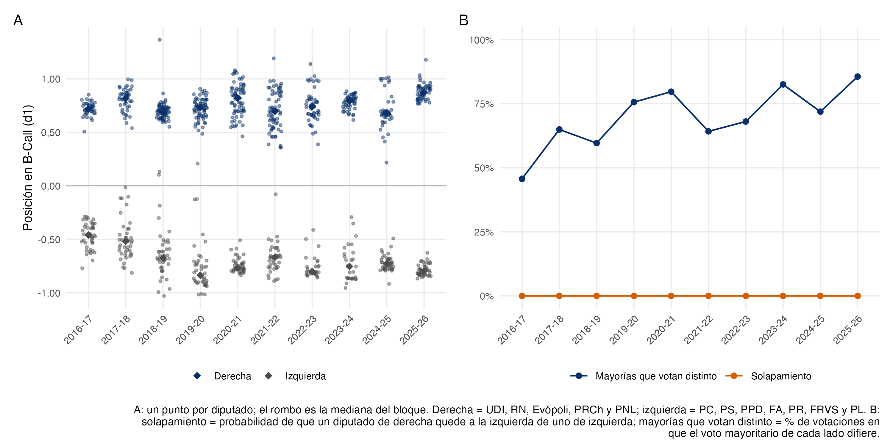{#fig-separacion fig-align="center" width="100%"}

En el panel A, cada punto es un diputado y el rombo es la mediana del bloque. La derecha queda entre +0,7 y +0,9 y la izquierda entre −0,5 y −0,8, con el cero vacío. En el panel B, la línea naranja es el solapamiento $\Omega$, que vale 0 todos los años: ningún diputado de derecha queda a la izquierda de un diputado de izquierda. La distancia estandarizada va de 7,6 a 25,5 desviaciones. La línea azul es el porcentaje de votaciones en que la mayoría de cada lado vota distinto. Sube de 46% en 2016-17 a 76% en 2019-20 y a 86% en 2025-26: la Cámara se polariza en el período.

El mapa clásico de B-Call muestra ese mismo bloque para 2022-2026 (@fig-mapa), con la variabilidad en el eje vertical.

{#fig-mapa fig-align="center" width="100%"}

La nube se parte en dos y el centro del eje queda casi vacío. A la izquierda, entre cerca de −1 y −0,5, están el PC, el PS, el Frente Amplio, el PPD y la DC. A la derecha, desde cerca de 0,5 hasta el extremo, están la UDI, RN, Evópoli, los independientes que votan con la derecha y el PRCh, cuyos triángulos se superponen con la UDI. La @tbl-camara pone esa posición en la escala anual común $P$. En los cuatro años en que el PRCh tiene bancada, UDI, RN y Evópoli quedan entre 1,70 y 2,18 desviaciones de la izquierda, y el PRCh entre 2,10 y 2,47.

| Año legislativo | PRCh | UDI | RN | Evópoli | PRCh − UDI |
|---|---:|---:|---:|---:|---:|
| 2022-23 | 2,44 | 2,14 | 1,99 | 1,70 | +0,30 |
| 2023-24 | 2,13 | 2,18 | 2,07 | 2,00 | −0,05 |
| 2024-25 | 2,47 | 2,00 | 1,99 | 1,70 | +0,47 |
| 2025-26 | 2,10 | 2,15 | 2,02 | 2,05 | −0,05 |

: Posición $P$ en la escala anual común: mediana del partido menos mediana de la izquierda, en desviaciones estándar de los diputados del año. Evópoli tiene dos diputados de 2022-23 a 2025-26. {#tbl-camara}

La última columna de @tbl-camara es la brecha entre el PRCh y la UDI. Como fracción de la distancia entre la UDI y la izquierda, va de −0,02 a 0,24 (@tbl-cuanto, más abajo). En dos años el PRCh queda un poco más a la derecha y en los otros dos la diferencia desaparece. La primera parte de H1 se cumple sin ambigüedad: la vara existe y es grande.

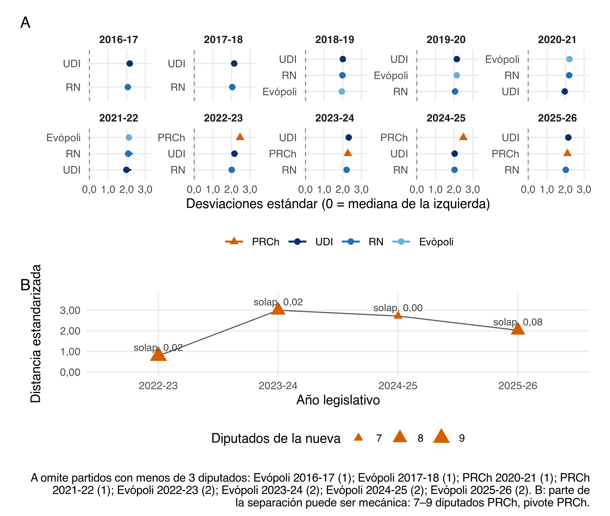{#fig-posicion fig-align="center" width="100%"}

@fig-posicion extiende esa escala a toda la década. En el panel A, UDI y RN se mantienen cerca de 2 desde 2016-17, y el PRCh aparece en 2022-23 junto a ellos. El panel B cambia de pregunta: mide la distancia entre la nueva derecha y la tradicional dentro de un B-Call calculado solo entre ellas. Esa distancia pasa de 0,77 en 2022-23 a 2,99 en 2023-24 y 2,71 en 2024-25, y baja a 2,02 en 2025-26. Es más grande que la de la Cámara porque está expresada en desviaciones de un grupo muy cohesionado, y parte de ella puede venir de cómo B-Call orienta cada votación entre dos grupos (@sec-bcall).

## Cohesión dentro de cada partido y bloque {#sec-dentro}

Dentro de la derecha, cada partido vota muy unido. @fig-cohesion-dentro lo muestra con dos medidas.

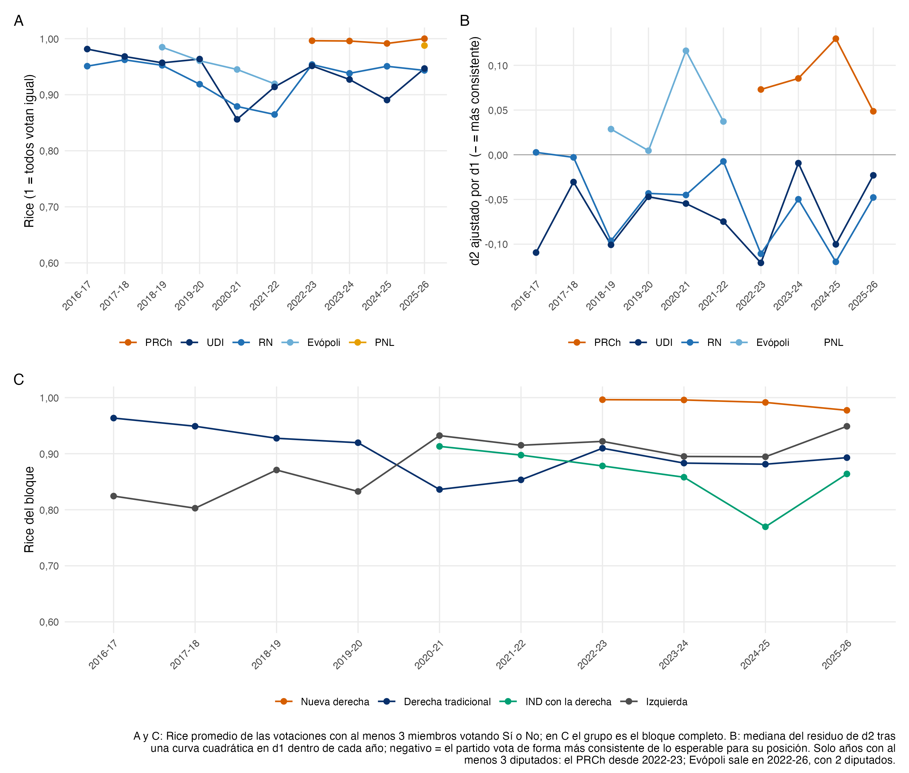{#fig-cohesion-dentro fig-align="center" width="100%"}

En el panel A, el Rice del PRCh está entre 0,99 y 1,00 todos los años: sus diputados votan casi siempre igual. La UDI y RN están entre 0,86 y 0,96. Su punto más bajo cae en 2020-21 y 2021-22, al final del gobierno de Piñera, con la UDI en 0,86 y RN en 0,87, y se recuperan a 0,95 en 2022-23. El panel C repite la medida por bloque. La derecha tradicional baja de 0,96 en 2016-17 a entre 0,88 y 0,91 en 2022-26; la nueva derecha queda sobre 0,97; la izquierda sube de 0,82 a 0,95, y los independientes con la derecha son el bloque menos cohesionado (0,77 en 2024-25).

El panel B agrega un matiz. El $d2$ ajustado del PRCh es positivo todos los años (+0,05 a +0,13), y el de la UDI y RN es negativo. Con un Rice cercano a 1, ese $d2$ más alto no es indisciplina: el PRCh vota como un bloque compacto que se aparta, en conjunto, del eje que ordena al resto de la derecha. Con 7 a 9 diputados por año en B-Call, además, su Rice tiende a salir alto por tamaño.

## Cohesión entre las derechas {#sec-entre}

La división dentro de la derecha aparece cuando se juntan los partidos. @fig-cohesion-entre la muestra con el acuerdo de mayorías y con la pérdida $\Delta$.

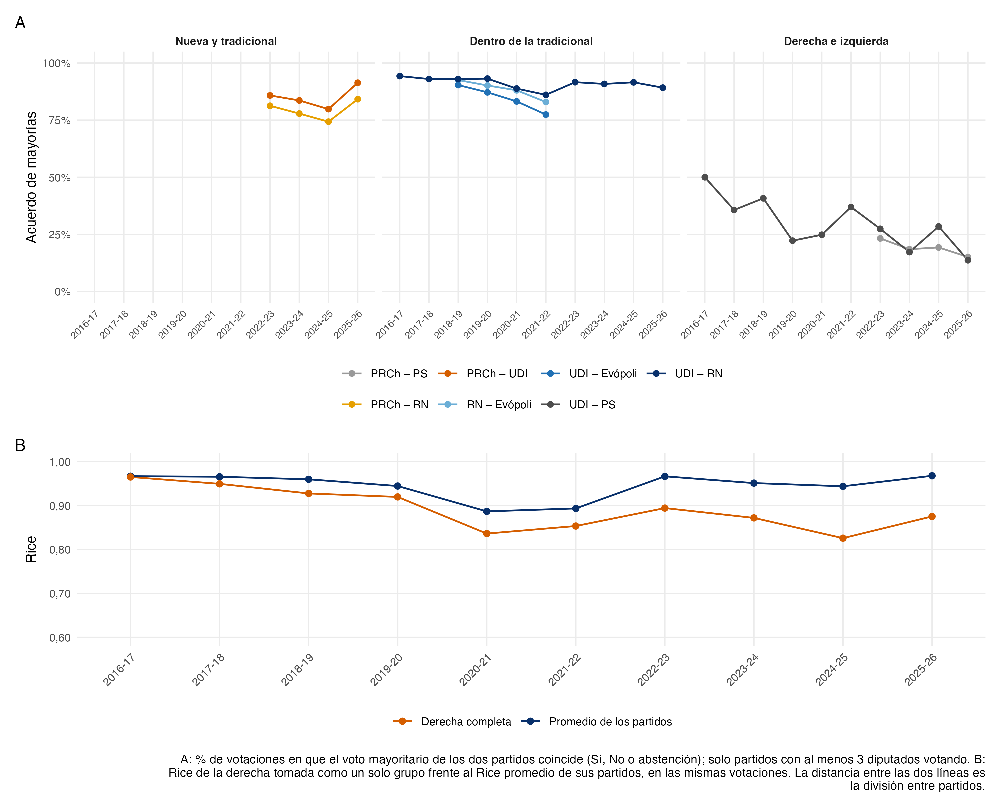{#fig-cohesion-entre fig-align="center" width="100%"}

| Par | 2022-23 | 2023-24 | 2024-25 | 2025-26 |
|---|---:|---:|---:|---:|
| UDI y RN | 92 | 91 | 92 | 89 |
| PRCh y UDI | 86 | 84 | 80 | 91 |
| PRCh y RN | 81 | 78 | 74 | 84 |
| PRCh y PS | 23 | 19 | 19 | 15 |
| UDI y PS | 27 | 17 | 28 | 14 |

: Acuerdo de mayorías, en porcentaje de votaciones en que el voto mayoritario de los dos partidos coincide. {#tbl-acuerdo}

La @tbl-acuerdo da los números del panel A para los años del PRCh. La UDI y RN coinciden en torno al 90%, como en toda la década (entre 86% y 94% desde 2016-17). El PRCh coincide más con la UDI que con RN, y ambos acuerdos bajan hasta 2024-25 y se recuperan en 2025-26. Como vara, el PRCh coincide con el PS casi tan poco como la UDI. Antes de 2022, el par más distante dentro de la derecha era UDI y Evópoli, que cae de 90% a 77% entre 2018-19 y 2021-22.

El panel B es la medida más directa de H2. Con solo UDI y RN, en 2016-17, la pérdida $\Delta$ es 0,002: juntarlos no cambia la cohesión. Con Evópoli, entre 2018-19 y 2021-22, sube a entre 0,03 y 0,05. Con el PRCh pasa a 0,07 en 2022-23, 0,08 en 2023-24 y 0,12 en 2024-25, y queda en 0,09 en 2025-26, ya con el PNL. Los partidos siguen votando unidos por dentro y la derecha como un todo vota menos unida. H2 se cumple: el PRCh abre una línea de división entre partidos y no fragmenta a los partidos tradicionales por dentro.

# Ordenar o desordenar {#sec-bloque2}

## Las etiquetas se desordenan {#sec-etiquetas}

El primer plano de H3 son las etiquetas. @fig-cambios cuenta los cambios de grupo que salen de un grupo de derecha o llegan a uno.

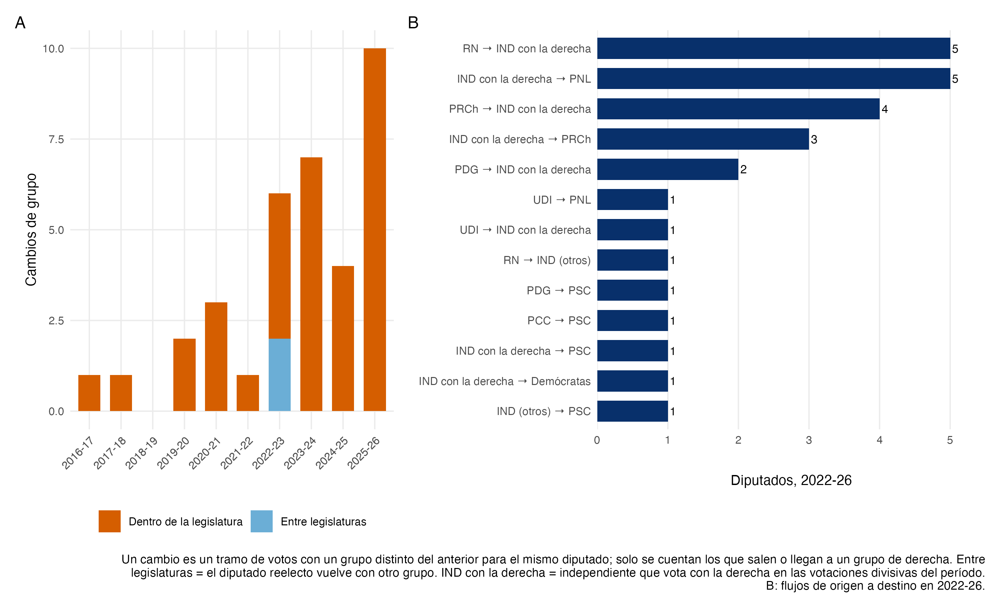{#fig-cambios fig-align="center" width="100%"}

Entre 2016-17 y 2021-22 hay entre cero y tres cambios por año. Desde 2022-23 hay entre 4 y 10, y casi todos ocurren dentro de una misma legislatura. El panel B muestra a dónde van. Cinco diputados dejan RN y uno la UDI para votar como independientes con la derecha. Cuatro republicanos, entre ellos Naveillan, De la Carrera y Kaiser, dejan el PRCh para votar como independientes, y en 2025-26 cinco independientes terminan en el PNL y tres vuelven al PRCh. El salto directo de un partido tradicional a la nueva derecha es raro: solo Urruticoechea, de RN al PRCh, y Labbé, de la UDI al PNL. El desorden está, sobre todo, en la propia nueva derecha, que se escinde y produce el PNL.

## El voto se ordena {#sec-voto}

El segundo plano de H3 es el voto, y ahí la imagen es la contraria. @fig-orden la muestra con tres medidas.

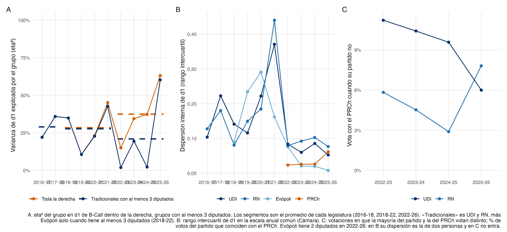{#fig-orden fig-align="center" width="100%"}

En el panel B, la dispersión interna de la UDI y RN llega a su máximo en 2021-22, con 0,37 y 0,44 desviaciones entre el cuarto más moderado y el más duro de cada partido. Desde 2022-23 cae a entre 0,05 y 0,10. En el panel A, la parte de la variación de $d1$ dentro de la derecha que explica el grupo sube de 15% en 2022-23 a 35% en 2023-24, 37% en 2024-25 y 63% en 2025-26: cada grupo ocupa cada vez más su propio tramo. Con solo la UDI y RN, la medida es volátil (2% en 2022-23 y 2024-25, 60% en 2025-26), lo que indica que la clasificación viene de la separación entre la nueva y la tradicional y no de una separación entre la UDI y RN. En el panel C, cuando la mayoría de su partido y la del PRCh votan distinto, solo entre 6% y 11% de los votos de la UDI siguen al PRCh, y entre 3% y 8% de los de RN.

H3 se cumple en sus dos partes. La entrada del PRCh desordena las etiquetas y ordena el voto: la derecha tradicional queda más compacta, mejor separada de la nueva y casi sin fugas hacia ella.

## A quiénes se llevó hacia la derecha {#sec-atraccion}

@fig-atraccion pregunta quién se movió. El panel A mide el acuerdo con la derecha: en las votaciones en que la mayoría de la derecha y la de la izquierda votan distinto, el porcentaje de veces que un diputado vota con la derecha. El panel B usa la escala común $P$.

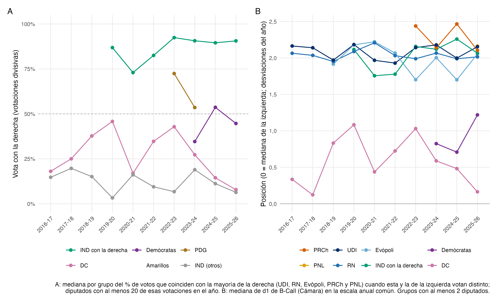{#fig-atraccion fig-align="center" width="100%"}

Los independientes con la derecha votan con ella más del 90% de las veces desde 2022-23: son derecha aunque no tengan partido. El centro se separa en dos. Demócratas, formado por exmilitantes de la DC, vota con la derecha entre 35% y 54% de las veces, y en la escala pasa de 0,82 a 1,22 desviaciones a la derecha de la izquierda. La DC va en la dirección contraria: de 43% en 2022-23 a 8% en 2025-26, y de 1,03 a 0,16 en la escala. Las posiciones de los partidos tradicionales no se mueven: la UDI está en 2,16 en 2016-17 y en 2,15 en 2025-26, y RN se mantiene cerca de 2,0.

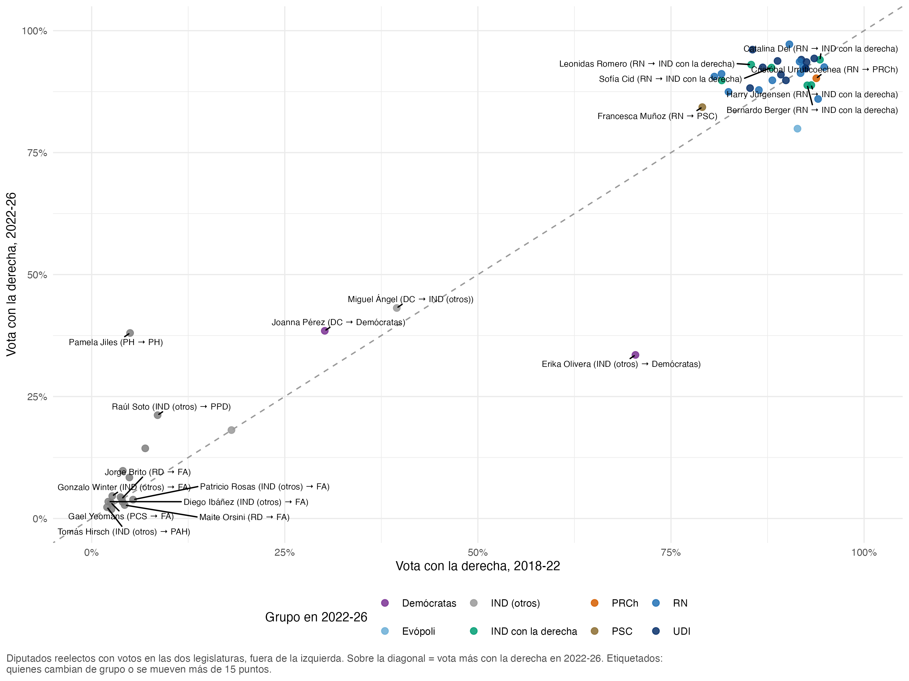{#fig-panel fig-align="center" width="85%"}

@fig-panel sigue a los mismos diputados en las dos legislaturas. Los 12 de RN y los 10 de la UDI que siguen en su partido suben 2 puntos, desde un nivel cercano al 90%. Los cinco que dejan RN para votar como independientes no cambian su voto (93% antes, 92% después): fue un cambio de etiqueta y no de comportamiento. Los movimientos grandes están fuera de la derecha, en el centro. H4 se cumple: el PRCh no arrastró a la UDI ni a RN, y el bloque se amplió hacia los independientes y una parte del centro.

# Qué movió a las derechas {#sec-bloque3}

## La agenda: qué se vota {#sec-agenda}

Antes de preguntar qué movió a las derechas conviene saber qué se votó. @fig-topicos cuenta las indicaciones por tópico principal y año.

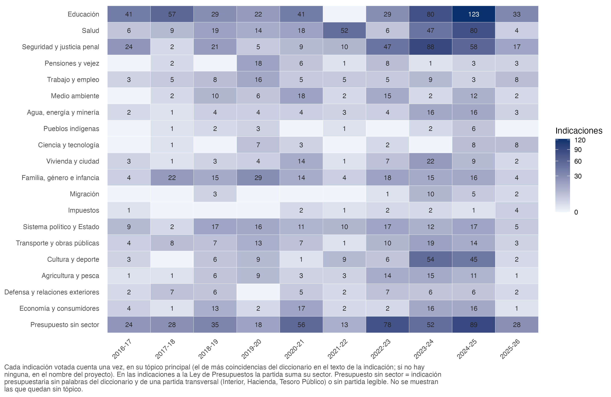{#fig-topicos fig-align="center" width="100%"}

El dato que más pesa es que el 75% de lo que se vota en indicaciones (2.007 de 2.677) son indicaciones a la Ley de Presupuestos, y que ese volumen crece desde 2022-23. Por eso educación (455 indicaciones como tópico principal), seguridad y justicia penal (281) y salud (255) dominan el conteo, con picos en 2023-24 y 2024-25. Seguridad es el cambio más claro del período 2022-26: de entre 3 y 25 indicaciones por año antes, pasa a 51 en 2022-23 y a 93 en 2023-24. Pensiones se concentra en 2019-20, el año de los retiros de fondos, y medio ambiente, pueblos indígenas y ciencia son marginales todos los años.

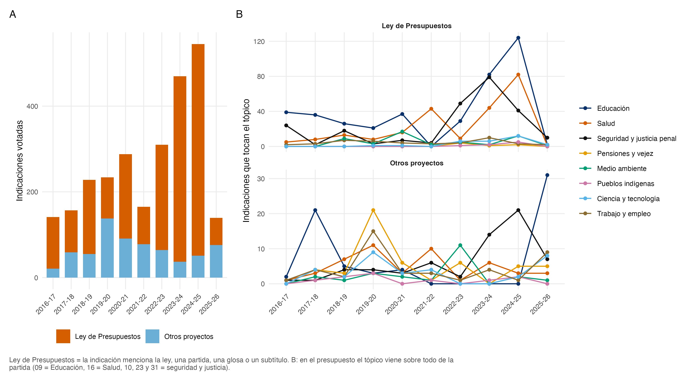{#fig-presupuesto-topicos fig-align="center" width="100%"}

@fig-presupuesto-topicos separa los dos mundos. De las 462 indicaciones que tocan educación, 396 son presupuestarias; de las 277 de salud, 229, y de las 300 de seguridad, 237. Pensiones es lo contrario: 51 de 58 vienen de otros proyectos. Lo que se vota en indicaciones es, sobre todo, cuánto gastar y en qué, y eso condiciona todo lo que sigue.

## El contenido: cinco ejes {#sec-ejes}

El libro de códigos de cinco ejes dice en qué consiste la división de la Cámara y cuánto se separan las derechas ante el mismo texto (@tbl-si y @fig-efecto).

| Polo del Sí | Nueva | Tradicional | IND con la derecha | Izquierda |
|---|---:|---:|---:|---:|
| Conservador | +43 | +19 | +25 | −31 |
| Soberanista | +16 | +28 | +17 | −30 |
| Orden y castigo | +14 | +13 | +11 | 0 |
| Pro-mercado | +4 | +4 | +4 | −9 |
| Provisión privada (provisional) | −7 | 0 | −3 | −6 |

: Coeficientes $\beta_k$, en puntos porcentuales de probabilidad de votar Sí cuando el texto va hacia el polo nombrado, frente a un texto que no toca el eje. Votos: nueva 4.035; tradicional 31.899; IND con la derecha 6.493; izquierda 27.566. {#tbl-si}

Ante un texto conservador, la nueva derecha sube 43 puntos, la tradicional 19 y la izquierda baja 31. Ante uno soberanista, la tradicional sube 28 y la nueva 16, mientras la izquierda baja 30. Ante orden y castigo, las derechas suben entre 11 y 14 puntos y la izquierda queda en cero. Ante un texto pro-mercado, las tres columnas de derecha suben 4 puntos y la izquierda baja 9.

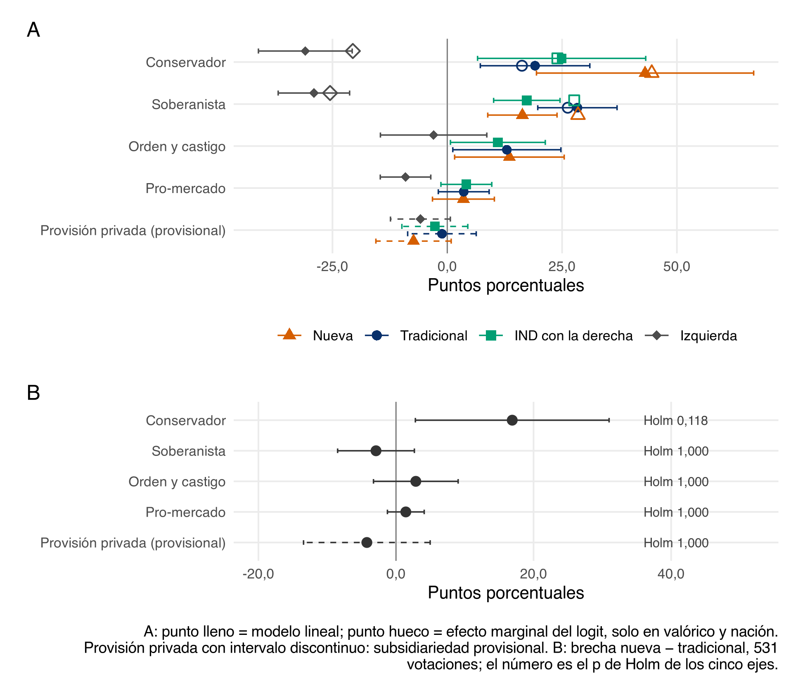{#fig-efecto fig-align="center" width="100%"}

El panel A de @fig-efecto dibuja esos coeficientes con su intervalo. Lo valórico y nación separan a la izquierda de las derechas; entre las derechas, el salto grande está en lo conservador. El panel B mide la brecha entre la nueva y la tradicional en las mismas 531 votaciones. Solo lo conservador se aparta de cero, en unos 17 puntos, con p = 0,024 antes de corregir por los cinco ejes y p = 0,118 después de la corrección de Holm.

| Medida | Nueva − tradicional | Tradicional − izquierda | R |
|---|---:|---:|---:|
| Posición en la Cámara, 2022-23 | +0,30 | 2,14 | 0,14 |
| Posición en la Cámara, 2023-24 | −0,05 | 2,18 | −0,02 |
| Posición en la Cámara, 2024-25 | +0,47 | 2,00 | 0,24 |
| Posición en la Cámara, 2025-26 | −0,05 | 2,15 | −0,02 |
| Sí ante texto conservador | +24 | 50 | 0,48 |
| Sí ante texto soberanista | −12 | 58 | −0,21 |
| Sí ante texto de orden | +1 | 13 | 0,08 |
| Sí ante texto pro-mercado | 0 | 13 | 0,00 |

: Distancia entre las derechas como fracción de la distancia entre la derecha tradicional y la izquierda ($R$). Posición: desviaciones estándar (@tbl-camara). Contenido: puntos porcentuales (@tbl-si). Provisión privada queda fuera: su kappa es 0,42 y la brecha entre izquierda y derecha es de 6 puntos. {#tbl-cuanto}

La @tbl-cuanto lleva todo a la escala de $R$. En la dimensión principal, $R$ va de −0,02 a 0,24. En economía y orden es 0 y 0,08: el texto mueve igual a las dos derechas. En nación es negativo, porque las dos derechas votan Sí casi siempre ante un texto soberanista y ese techo comprime el coeficiente de la nueva. Lo valórico es el único eje donde las derechas se separan con claridad, con $R = 0,48$, pero entre 2022 y 2026 hay solo 10 votaciones valóricas.

## El termómetro mercado-Estado {#sec-termometro}

El eje económico del libro de códigos dice que, ante un texto pro-mercado, las dos derechas suben lo mismo. El termómetro permite mirar el otro lado del eje, donde está casi todo lo que se vota, y seguirlo en el tiempo. @fig-indice muestra el índice $I$ por grupo y año.

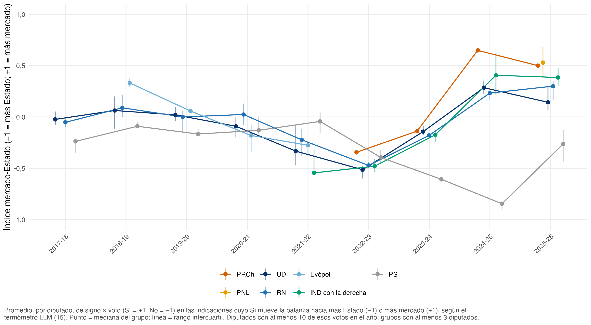{#fig-indice fig-align="center" width="100%"}

Entre 2017-18 y 2020-21, la UDI, RN y Evópoli quedan cerca de 0 y casi pegadas al PS. En 2021-22 y 2022-23 toda la Cámara baja hacia el Estado, con la UDI en −0,51 y el PRCh en −0,34 en 2022-23. Desde 2023-24 la derecha se corre hacia el mercado y el PS hacia el Estado. En 2024-25 el PRCh llega a +0,65, la UDI a +0,29, RN a +0,23, los independientes con la derecha a +0,41 y el PS a −0,85. En 2025-26 el PNL entra en +0,53, junto al PRCh (+0,50). El índice depende de la agenda: 2024-25 tiene 226 votaciones de más Estado, casi todas del presupuesto 2025, y por eso las comparaciones entre partidos dentro de un año son más firmes que las comparaciones entre años.

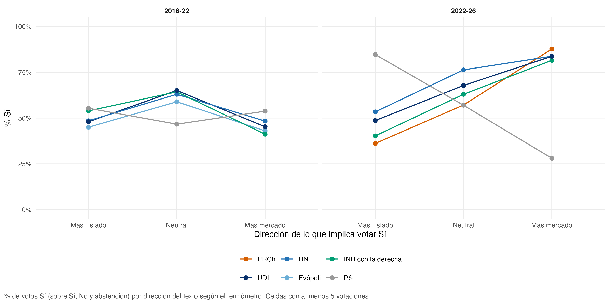{#fig-respuesta fig-align="center" width="100%"}

@fig-respuesta muestra de dónde sale ese movimiento. Bajo Piñera (2018-22), todas las derechas votan Sí entre 45% y 65% de las veces, sea cual sea la dirección del texto, y su pendiente es casi plana: apoyaban el gasto de su propio gobierno. Bajo Boric (2022-26) aparece una pendiente clara, y el PS la invierte. Ante textos de más mercado, todas las derechas votan Sí entre 81% y 88% de las veces: ahí no hay división. Ante textos de más Estado se separan: el PRCh vota Sí el 36% de las veces, el PNL el 35%, los independientes con la derecha el 40%, la UDI el 49% y RN el 53%. La sensibilidad $b_{gt}$ (figura A3) pasa de cerca de 0 en 2018-22 a +0,21 en la UDI y +0,19 en RN en 2024-25, y a +0,32 en el PRCh. Las mismas personas se mueven: entre los reelectos, el índice de la UDI sube 0,19 y el de RN 0,13, y los cinco que dejaron RN para votar como independientes son los que más se mueven (+0,39).

H5 se cumple con un matiz que el termómetro agrega. Las derechas convergen ante el mercado, como predice la hipótesis, y se separan ante el Estado. Esa separación no es simétrica: la derecha tradicional acepta la mitad de lo que amplía el Estado y el PRCh, un tercio.

## Qué divide y qué une {#sec-divide}

@fig-divide ordena las votaciones de 2022-26 según lo que predice que las mayorías de las dos derechas voten distinto.

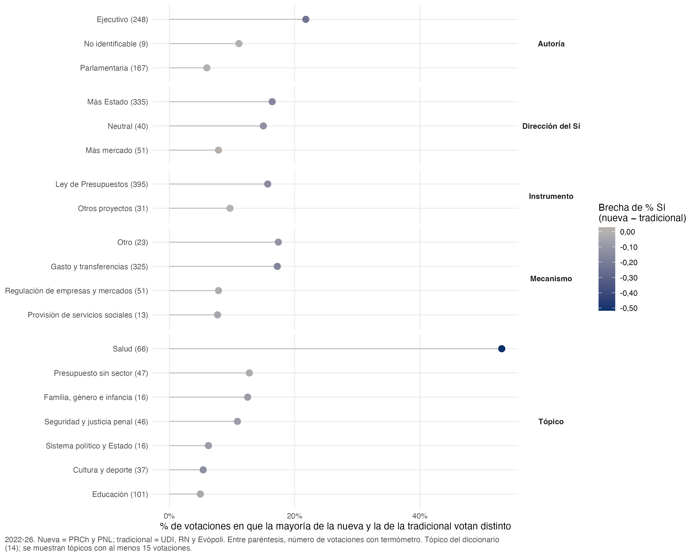{#fig-divide fig-align="center" width="100%"}

| Variable | Coeficiente | IC 95% |
|---|---:|---|
| Autoría del Ejecutivo (frente a parlamentaria) | +0,14 | 0,07 a 0,22 |
| Autoría de comisión | −0,10 | −0,28 a 0,08 |
| Texto de más Estado (frente a neutral) | −0,04 | −0,17 a 0,08 |
| Texto de más mercado (frente a neutral) | −0,04 | −0,18 a 0,10 |
| Ley de Presupuestos (frente a otros proyectos) | −0,04 | −0,16 a 0,08 |

: Modelo lineal de probabilidad de que la mayoría de la nueva derecha y la de la tradicional voten distinto, 2022-26, con efectos fijos por año. 417 votaciones con termómetro y autoría identificable. {#tbl-divide}

El corte decisivo es quién firma. La mayoría del PRCh y la de la derecha tradicional votan distinto en el 22% de las 248 indicaciones del Ejecutivo y en el 6% de las 167 de diputados. En el modelo de @tbl-divide, con la dirección del texto, el presupuesto y el año controlados, la autoría del Ejecutivo suma 14 puntos a la probabilidad de división (p < 0,001), y la dirección del texto deja de importar. Por dirección, sin controles, dividen más los textos de más Estado (16%) que los de más mercado (8%); por mecanismo, el gasto (17%) más que la regulación (8%).

El caso más nítido son 35 indicaciones del Ejecutivo al presupuesto 2025 que reponen gasto recortado a servicios de salud. La derecha tradicional votó Sí cerca del 97% de las veces y el PRCh, 0%. Por eso salud es el tópico que más divide, con 53% de sus 66 votaciones. Unen la educación (5% de 101 votaciones), la cultura (5%), los textos de más mercado, la regulación y las indicaciones de diputados.

## La táctica en el presupuesto {#sec-presupuesto}

El presupuesto acerca el diseño a un panel, porque las mismas partidas se votan cada año. @tbl-presupuesto y @fig-presupuesto muestran el No, el acuerdo con la mayoría republicana y el apoyo a las rebajas simbólicas en las leyes 2023 a 2026.

| Ley | Partido | % No | % igual al PRCh | % Sí a rebajas | Votaciones |
|---|---|---:|---:|---:|---:|
| 2023 | PRCh | 33 | 99 | 84 | 290 |
| 2023 | UDI | 28 | 82 | 82 | 290 |
| 2023 | RN | 24 | 78 | 85 | 290 |
| 2023 | Evópoli | 30 | 67 | 67 | 286 |
| 2024 | PRCh | 51 | 99 | 97 | 517 |
| 2024 | UDI | 45 | 76 | 82 | 517 |
| 2024 | RN | 41 | 70 | 63 | 517 |
| 2024 | Evópoli | 47 | 68 | 44 | 504 |
| 2025 | PRCh | 67 | 100 | 100 | 601 |
| 2025 | UDI | 46 | 73 | 95 | 601 |
| 2025 | RN | 46 | 70 | 83 | 601 |
| 2025 | Evópoli | 43 | 64 | 40 | 589 |
| 2026 | PRCh | 53 | 100 | no hubo | 110 |
| 2026 | PNL | 48 | 96 | no hubo | 110 |
| 2026 | UDI | 43 | 91 | no hubo | 110 |
| 2026 | RN | 42 | 88 | no hubo | 110 |
| 2026 | Evópoli | 40 | 80 | no hubo | 106 |

: Leyes de Presupuestos 2023 a 2026, votadas en noviembre del año anterior. «% igual al PRCh» es el porcentaje de votos del partido que coincide con la mayoría republicana. {#tbl-presupuesto}

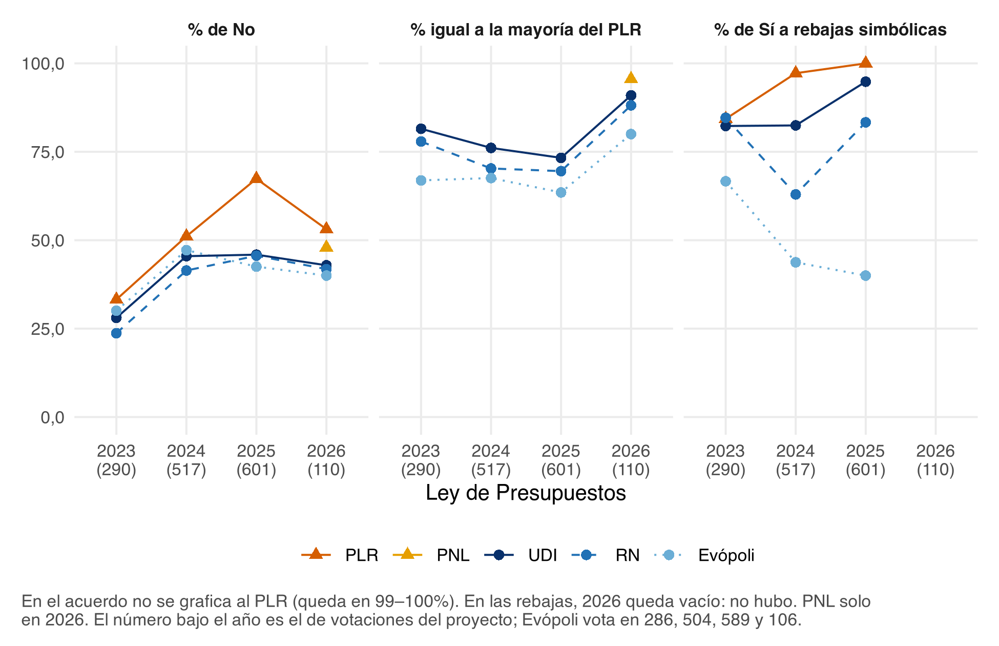{#fig-presupuesto fig-align="center" width="100%"}

El No del PRCh pasa de 33% en la ley 2023 a 51% en 2024 y 67% en 2025, y baja a 53% en 2026. UDI, RN y Evópoli suben también entre 2023 y 2024 y después se quedan entre 40% y 46%. Con la partida fija, el No de la UDI sube 17 puntos en 2024 y 16 en 2025 (p < 0,001): un endurecimiento en la misma dirección, más lento. El acuerdo de la UDI con la mayoría republicana baja de 82% a 73% entre 2023 y 2025 y vuelve a 91% en 2026, y RN y Evópoli siguen la misma curva por debajo. En las rebajas simbólicas, el PRCh pasa de 84% a 100% y la UDI de 82% a 95%, mientras Evópoli hace el camino inverso, de 67% a 40%. Es la misma historia que el termómetro cuenta con otros datos: la división crece en el presupuesto que el gobierno de Boric presenta en 2024 y se cierra en el de 2026.

# Discusión {#sec-discusion}

La respuesta a la pregunta del título tiene tres partes. La izquierda y la derecha se separan por completo, y esa división sigue ordenando la Cámara. Dentro de la derecha, la diferencia que trajo el PRCh es una línea entre partidos cohesionados, que desordenó las etiquetas y ordenó el voto. Y esa línea se abre en un lugar preciso: en cuánto Estado acepta cada derecha cuando lo propone un gobierno de izquierda. Cinco de las seis hipótesis encuentran apoyo; la parte valórica de H5 y la oscilación electoral de H6 quedan como sugerentes.

| Hipótesis | Resultado | Lectura |
|---|---|---|
| H1. Jerarquía de distancias | Solapamiento izquierda-derecha 0 todos los años; R de −0,02 a 0,24 en la posición | Se cumple |
| H2. División entre partidos | Rice partidario de 0,86 a 1,00; pérdida $\Delta$ de 0,002 (2016-17) a 0,07–0,12 (2022-25) | Se cumple |
| H3. Desorden de etiquetas, orden del voto | Cambios de grupo de 0–3 a 4–10 por año; dispersión de UDI y RN de 0,37–0,44 a 0,05–0,10; $\eta^2$ de 15% a 63% | Se cumple |
| H4. Atracción hacia la derecha | UDI de 2,16 a 2,15; independientes con la derecha sobre 90%; Demócratas de 0,82 a 1,22 | Se cumple |
| H5. Contenido | Pro-mercado +4 en ambas, R = 0; más mercado 81–88% de Sí en todas; conservador +43 frente a +19, Holm p = 0,118 | Se cumple en economía y orden; sugerente en lo valórico |
| H6. Táctica | Ejecutivo +14 pp de división; No del PRCh en el presupuesto de 33% a 67%; acuerdo UDI–PRCh 82, 76, 73 y 91% | Se cumple; la oscilación electoral es sugerente |

: Hipótesis y lectura. {#tbl-hipotesis}

La @tbl-hipotesis resume la lectura fila por fila. El resultado calza con una división principal que sigue siendo la de los dos bloques (Tironi y Agüero, 1999; Alemán y Saiegh, 2007). El PRCh no abre una segunda división en el voto: es un polo dentro del bloque de derecha. En el contenido, el resultado es coherente con lo que anticipaban Díaz et al. (2023): la relación fluida entre ambas derechas facilita la cooperación, y ante el mismo texto de mercado votan igual.

El aporte de separar la cohesión dentro y entre partidos es que cambia el diagnóstico de lo que le pasó a ChV. Una lectura apresurada del Rice de la derecha tradicional, que baja de 0,96 a cerca de 0,88, sugeriría que el PRCh la desordenó. Las medidas de orden dicen lo contrario. La UDI y RN quedaron más compactas que nunca, mejor separadas de la nueva derecha y casi sin fugas hacia ella. Lo que bajó es la cohesión de la derecha completa, y bajó porque ahora tiene dos polos. Esa es la forma esperable de una escisión (Heller y Mershon, 2009): los que se fueron se llevaron su diferencia, y algunos de ellos, como muestra la serie de cambios de grupo, siguieron moviéndose dentro de la propia nueva derecha.

Los datos matizan la tesis de la sobreadaptación (Rovira Kaltwasser, 2019). Si ChV moderó su programa en economía, esa moderación no aparece en el voto ante textos de mercado, donde ChV y el PRCh votan igual. Aparece, en cambio, ante el Estado: la derecha tradicional acepta la mitad de lo que el gobierno de Boric propone para ampliar el Estado, y el PRCh un tercio. Esa diferencia no se explica solo por el contenido, porque desaparece cuando el texto lo firma un diputado. Es contenido y táctica a la vez, y el eje mercado-Estado es justo el lugar donde el artículo puede separarlos.

Que la diferencia esté en la oposición al Ejecutivo tampoco es una anomalía. La derecha chilena ya se dividió por la forma de hacer oposición: entre 2002 y 2006, la UDI aprobó cerca del 11% de los proyectos del Ejecutivo y RN cerca del 36% (Toro Maureira, 2007). En Europa, los partidos populistas hacen oposición con menos colaboración legislativa y más control del gobierno (Louwerse y Otjes, 2019). Lo nuevo en Chile es quién ocupa el polo duro: en 2002–2006 era la UDI; hoy es el PRCh, y la UDI lo sigue a medias.

Los resultados apoyan la hipótesis general del Fondecyt en el plano parlamentario. El PRCh combina dos estrategias: vota como la derecha convencional ante el mercado y en casi todo el contenido, lo que sirve a su legitimación, y se diferencia en la oposición al gasto del Ejecutivo y, débilmente, en lo valórico, lo que refuerza su núcleo. Para ChV, los datos se parecen a una acomodación parcial en la tipología de Meguid (2008): endurece su oposición sin alcanzar al PRCh, mantiene su propia cohesión y su propia posición, y no pierde votos hacia el polo radical.

La oscilación electoral tiene una primera evidencia. El acuerdo con el PRCh cae hasta el presupuesto 2025, tramitado en torno a las municipales y regionales de 2024, y sube en el de 2026, tramitado durante la campaña presidencial de 2025. Falta fechar la tramitación y contrastarlo con el seguimiento de prensa del proyecto. Evópoli es el caso que el Fondecyt anticipa como reactivación de sensibilidades moderadas: se aleja de las rebajas simbólicas, es la más cercana al centro en la escala de la Cámara en 2022-23 y 2024-25 (1,70) y fue, antes de 2022, el socio con el que la UDI coincidía menos.

## Robustez {#sec-robustez}

Estas lecturas tienen límites, y cada uno califica una figura o una tabla.

El primero es el gobierno. El PRCh entra a la Cámara justo cuando la derecha tradicional pasa de gobernar con Piñera a ser oposición a Boric. La recuperación del Rice de la UDI y RN en 2022-23, la caída de su dispersión interna y el cambio de pendiente en @fig-respuesta pueden deberse en parte a ese cambio de rol. Lo que separa los dos efectos es la comparación entre partidos dentro de cada año, y esa comparación es la que sostiene H2, H3 y H6.

El segundo es la agenda. El índice $I$ y la sensibilidad $b_{gt}$ dependen de qué se votó, y 2024-25 tiene 226 votaciones de más Estado, casi todas del presupuesto 2025. El termómetro, además, solo es confiable en el signo: el kappa ponderado de la intensidad es 0,29. Hay solo 78 votaciones de más mercado en diez años, y la convergencia ante el mercado descansa en pocos textos.

El tercero es B-Call dentro de la derecha. El panel B de @fig-posicion y la clasificación $\eta^2$ usan el universo de la derecha, donde el pivote republicano orienta las votaciones para separar a los grupos. Falta una prueba de permutación que diga cuánto de esa separación aparece con grupos al azar del mismo tamaño. Con 7 a 9 republicanos en B-Call, su Rice tiende a salir alto por tamaño. Evópoli tiene dos diputados en 2022-26, así que su dispersión es la de dos personas y no entra en la atracción.

El cuarto es el contenido. $R$, en @tbl-cuanto, es un cociente de estimaciones puntuales y todavía no tiene intervalo. Entre 2022 y 2026 hay solo 10 votaciones valóricas, y la brecha conservadora no pasa la corrección de Holm. La guerra cultural casi no pasa por las indicaciones, y fuera de ellas el texto disponible es pobre: 1.124 resoluciones no traen el cuerpo. La autoría se identifica con una heurística sobre el encabezado, y 9 votaciones de 2022-26 quedan sin autoría identificable. Falta también contrastar la escala de @tbl-camara con los puntos ideales de Fábrega (2025).

## Cierre

La izquierda y la derecha siguen siendo los dos polos de la Cámara. Entre las derechas, la distancia es una fracción de esa división y está entre partidos, no dentro de ellos. El PRCh desordenó las etiquetas de la derecha y ordenó su voto: ChV quedó más compacta, sin moverse de lugar, y el bloque creció hacia los independientes y una parte del centro. Lo que divide a las dos derechas no es el mercado, donde votan igual, sino cuánto Estado aceptan cuando lo propone un gobierno de izquierda. Esa combinación calza con la estrategia dual que el Fondecyt atribuye a la derecha radical, y con una derecha convencional que se acomoda sin mimetizarse.

# Apéndice {.unnumbered}

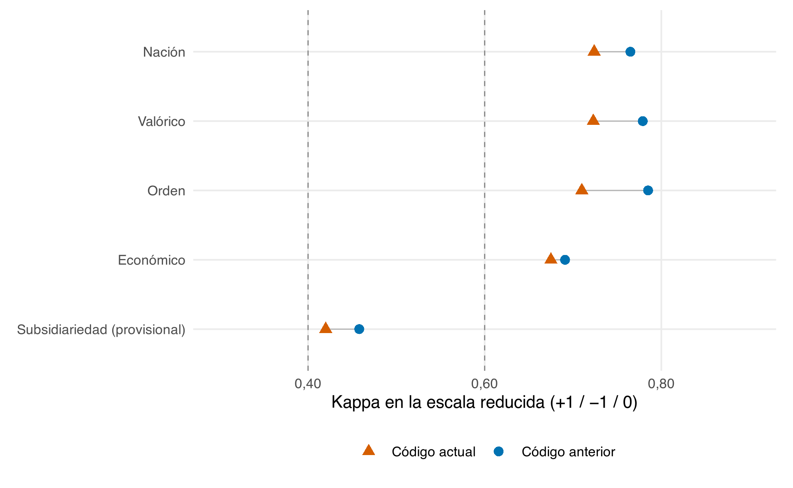{fig-align="center" width="92%"}

La figura A1 compara el acuerdo entre los dos modelos en la escala reducida. El triángulo es el código actual y el círculo el anterior. Nación, valórico, orden y económico quedan sobre 0,60 en los dos códigos. Subsidiariedad queda junto a 0,40, y por eso el eje sigue como provisional.

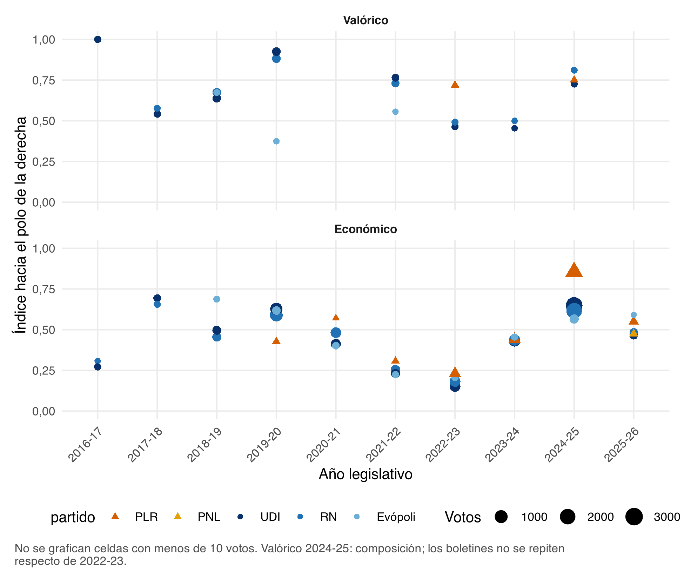{fig-align="center" width="92%"}

La figura A2 muestra el índice del libro de códigos por partido y año, de 0 a 1 hacia el polo de la derecha. En lo valórico, UDI y RN se mueven juntas, y el PRCh, cuando entra con suficientes votos, queda en el mismo tramo. El salto valórico de 2024-25 es de composición: los boletines no se repiten respecto de 2022-23.

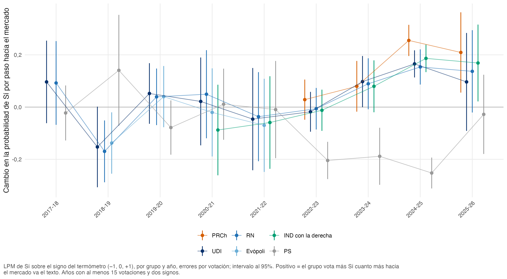{fig-align="center" width="92%"}

La figura A3 muestra la pendiente $b_{gt}$ de @sec-modelos. Entre 2018-19 y 2022-23, la UDI, RN y Evópoli oscilan en torno a cero. Desde 2023-24 la pendiente de la derecha es positiva y la del PS negativa. En 2024-25, el año del presupuesto 2025, el PRCh llega a +0,32, la UDI a +0,21 y RN a +0,19.

# Referencias {.unnumbered}

::: {.referencias}
Abou-Chadi, T. y Krause, W. (2020). The causal effect of radical right success on mainstream parties' policy positions: A regression discontinuity approach. *British Journal of Political Science*, 50(3), 829–847. https://doi.org/10.1017/S0007123418000029

Alemán, E. y Saiegh, S. M. (2007). Legislative preferences, political parties, and coalition unity in Chile. *Comparative Politics*, 39(3), 253–272.

Alenda, S. (ed.) (2020). *Anatomía de la derecha chilena: Estado, mercado y valores en tiempos de cambio*. Fondo de Cultura Económica.

Bale, T., Green-Pedersen, C., Krouwel, A., Luther, K. R. y Sitter, N. (2010). If you can't beat them, join them? Explaining social democratic responses to the challenge from the populist radical right in Western Europe. *Political Studies*, 58(3), 410–426.

Bale, T. y Rovira Kaltwasser, C. (eds.) (2021). *Riding the populist wave: Europe's mainstream right in crisis*. Cambridge University Press.

Carey, J. M. (2007). Competing principals, political institutions, and party unity in legislative voting. *American Journal of Political Science*, 51(1), 92–107.

Díaz, C., Rovira Kaltwasser, C. y Zanotti, L. (2023). The arrival of the populist radical right in Chile: José Antonio Kast and the «Partido Republicano». *Journal of Language and Politics*, 22(3), 342–359. https://doi.org/10.1075/jlp.22131.dia

Downs, W. M. (2001). Pariahs in their midst: Belgian and Norwegian parties react to extremist threats. *West European Politics*, 24(3), 23–42.

Fábrega, J. (2025). Ideological positions in the Chilean Chamber of Deputies (2002–2026): A legislative roll-call dataset. *Data in Brief*, 63, 112163. https://doi.org/10.1016/j.dib.2025.112163

Gidron, N. y Ziblatt, D. (2019). Center-right political parties in advanced democracies. *Annual Review of Political Science*, 22, 17–35.

Gilardi, F., Alizadeh, M. y Kubli, M. (2023). ChatGPT outperforms crowd workers for text-annotation tasks. *Proceedings of the National Academy of Sciences*, 120(30), e2305016120.

Heller, W. B. y Mershon, C. (eds.) (2009). *Political parties and legislative party switching*. Palgrave Macmillan.

Hix, S. y Noury, A. (2016). Government-opposition or left-right? The institutional determinants of voting in legislatures. *Political Science Research and Methods*, 4(2), 249–273.

Hix, S., Noury, A. y Roland, G. (2005). Power to the parties: Cohesion and competition in the European Parliament, 1979–2001. *British Journal of Political Science*, 35(2), 209–234.

Krause, W., Cohen, D. y Abou-Chadi, T. (2023). Does accommodation work? Mainstream party strategies and the success of radical right parties. *Political Science Research and Methods*, 11(1), 172–179.

Louwerse, T. y Otjes, S. (2019). How populists wage opposition: Parliamentary opposition behaviour and populism in Netherlands. *Political Studies*, 67(2), 479–495.

Meguid, B. M. (2008). *Party competition between unequals: Strategies and electoral fortunes in Western Europe*. Cambridge University Press.

Mudde, C. (2019). *The far right today*. Polity.

Pollack, M. (1999). *The new right in Chile, 1973–97*. Macmillan.

Rice, S. A. (1925). The behavior of legislative groups: A method of measurement. *Political Science Quarterly*, 40(1), 60–72.

Rovira Kaltwasser, C. (2019). La (sobre)adaptación programática de la derecha chilena y la irrupción de la derecha populista radical. *Colombia Internacional*, 99, 29–61. https://doi.org/10.7440/colombiaint99.2019.02

Santos, N., Serra-Silva, S. y Silva, T. (2025). The role of radical right parties in escalating parliamentary conflict: Policy issues and party responses in Portugal. *Frontiers in Political Science*, 7, 1553921. https://doi.org/10.3389/fpos.2025.1553921

Sartori, G. (1976). *Parties and party systems: A framework for analysis*. Cambridge University Press.

Tironi, E. y Agüero, F. (1999). ¿Sobrevivirá el nuevo paisaje político chileno? *Estudios Públicos*, 74, 151–168.

Torcal, M. y Mainwaring, S. (2003). The political recrafting of social bases of party competition: Chile, 1973–95. *British Journal of Political Science*, 33(1), 55–84.

Toro Maureira, S. (2007). Conducta legislativa ante las iniciativas del Ejecutivo: unidad de los bloques políticos en Chile. *Revista de Ciencia Política*, 27(1), 23–41.

Toro-Maureira, S., Reutter, J., Valenzuela, L., Alcatruz, D. y Valenzuela, M. (2025). B-Call: Integrating ideological position and voting cohesion in legislative behavior. *Frontiers in Political Science*, 7, 1670089.
:::
