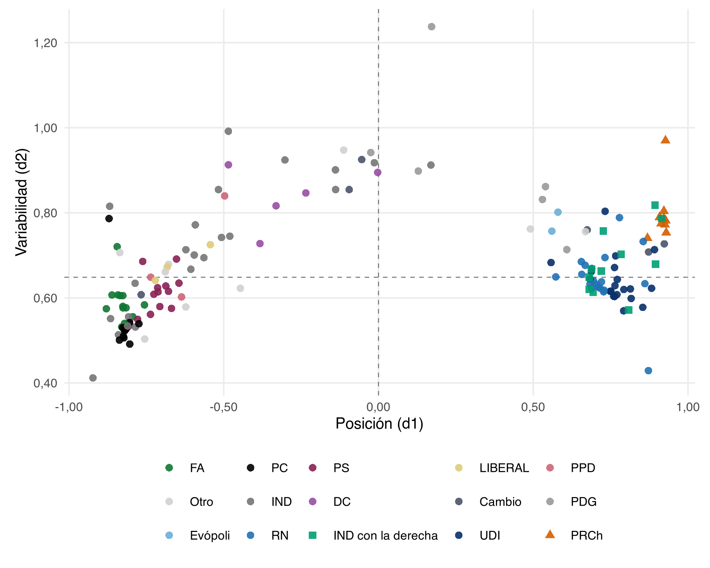

<!--
MARCADORES
[ACTUALIZAR: ...]  cifra que falta o que hay que recalcular; la fuente va indicada.
[PENDIENTE: ...]   resultado que todavía no existe (validación humana, recodificación).
Antes de enviar a una revista no debe quedar ninguno.
-->

# Resultados principales {.unnumbered}

- El PRCh no partió a la derecha ni arrastró a Chile Vamos: dejó un bloque con dos polos.
- La derecha no votó más parecido a la izquierda: votó menos. Las mayorías de cada lado difieren en el 32% de las votaciones de 2016-17 y en el 59% de las de 2025-26 (en las indicaciones, en el 46% y el 86%). La Cámara se polariza.
- Chile Vamos no se derechizó. La UDI está a 2,16 desviaciones de la izquierda en 2016-17 y a 2,15 en 2025-26. En términos brutos se aleja, pero porque toda la Cámara se estira. El PRCh queda algo más a la derecha; eso es un polo nuevo, no un corrimiento de la derecha convencional.
- El centro se parte: Demócratas vota con la derecha entre 36% y 53% de las veces y la DC baja de 44% a 9%. En la escala de posición, Demócratas queda del lado de la derecha y la DC se acerca a la izquierda.
- Cada partido vota cohesionado, pero la mayoría de algún partido de derecha vota contra la del bloque en hasta un cuarto de las votaciones. La mayoría republicana y la de Chile Vamos difieren tres a cuatro veces más que la UDI y RN cuando ambas eran oposición a Bachelet.
- Ante el mismo texto, las dos derechas responden igual en lo económico, una vez que cada una puede reaccionar distinto a quién lo propone. En lo valórico la brecha es estable pero imprecisa.
- Tampoco se oponen de manera distinta a las iniciativas del Ejecutivo.
- Lo que distingue al PRCh es cuándo se aparta: vota No 17 puntos más que la UDI cuando su voto no decide el resultado, y cerca de 4 cuando sí lo decide.
- El modelo de lenguaje abre lo que las posiciones ideales no registran: qué implica votar Sí ante el mismo texto. Un diccionario no alcanza, porque la misma materia cambia de signo según la operación.
- También tiene límites. El acuerdo entre modelos es de 0,68 a 0,72 en cuatro ejes y de 0,42 en subsidiariedad, que queda fuera. El termómetro solo sirve en el signo. El enmascarado de autores falló en el 10% de los textos. Tres cuartos de las indicaciones son del presupuesto, y en 2022-26 hay 10 votaciones valóricas.

# Introducción {#sec-intro}

En la elección de consejeros constitucionales del 7 de mayo de 2023, el Partido Republicano (PRCh) obtuvo 35,5% de los votos y Chile Vamos (ChV), la coalición de la derecha convencional, 21%. En diciembre de 2025, José Antonio Kast, fundador del PRCh, ganó la elección presidencial, y asumió el 11 de marzo de 2026, un día después del cierre de nuestros datos.^[[ACTUALIZAR: citar los resultados oficiales del Servel.] Este artículo forma parte del proyecto Fondecyt N.º [ACTUALIZAR], «La derecha en disputa».] El ascenso fue rápido y nació dentro del propio bloque: Kast militó veinte años en la UDI antes de renunciar en 2016 y fundar el PRCh en 2019. La pregunta que deja es qué le ocurre a una derecha convencional cuando la derecha radical surge desde su interior: si el bloque se parte, si la derecha convencional es arrastrada hacia el polo radical o si ambas conviven, y en qué se diferencian cuando lo hacen.

La literatura comparada sobre cómo responde la derecha convencional al ascenso de la radical mide sus estrategias con lo que los partidos dicen, sobre todo en sus programas (Meguid, 2008; Bale et al., 2010; Abou-Chadi y Krause, 2020; Krause et al., 2023; Bale y Rovira Kaltwasser, 2021). Un programa puede moderarse mientras el voto muestra otra cosa. Los estudios que miran el voto parlamentario miden cuánto coinciden o se enfrentan los partidos (Santos et al., 2025) o dónde se ubica cada legislador; para Chile, Fábrega (2025) ofrece posiciones ideales de todos los diputados entre 2002 y 2026. Esas medidas dicen dónde está cada uno, pero no qué implicaba cada voto ni por qué dos partidos coinciden o se separan. Un Sí compartido puede ser contenido compartido o una misma posición frente al gobierno, dos lógicas que el voto nominal mezcla (Hix y Noury, 2016). El caso chileno deja el vacío a la vista: la derecha radical es una escisión de la convencional, y se ha anticipado que esa cercanía facilita la cooperación (Díaz et al., 2023) sin que se haya examinado en el comportamiento legislativo.

Este artículo examina esa relación con las votaciones nominales de la Cámara de Diputados entre 2016 y 2026. Usamos dos universos. Con todas las votaciones medimos posición y cohesión, con B-Call (Toro-Maureira et al., 2025) y W-NOMINATE. Con las votaciones sobre indicaciones, cuyo texto está disponible, un modelo de lenguaje codifica qué implicaba votar Sí, lo que permite comparar a las dos derechas ante el mismo contenido. A nivel de votación, estimamos cuándo se separan: según quién propone el texto y según si el voto republicano decidía o no el resultado.

El argumento tiene tres partes. Primero, la entrada del PRCh no partió a la derecha ni arrastró a ChV: dejó un bloque con dos polos. Cada partido vota cohesionado, pero la división entre partidos crece hasta que la mayoría de algún partido de derecha vota contra la del bloque en cerca de un cuarto de las votaciones, y la mayoría republicana y la de ChV difieren tres a cuatro veces más de lo que diferían la UDI y RN en la oposición a Bachelet. Segundo, esa división no está en el contenido económico: ante el mismo texto, las dos derechas responden igual una vez que se permite que cada una reaccione distinto a quién lo propone. Tercero, tampoco está en una oposición más dura al Ejecutivo, sino en el costo de diferenciarse. El PRCh vota No 17 puntos más que la UDI ante iniciativas del Ejecutivo cuando su voto no decide el resultado, y cerca de 4 puntos más cuando sí lo decide. La derecha radical chilena se diferencia cuando no cuesta.

El artículo hace tres aportes. En lo conceptual, separa la cohesión dentro de los partidos de la cohesión entre ellos, y el contenido de lo que se vota de las condiciones en que un partido se aparta de su bloque. En lo empírico, ofrece la primera medición sistemática de la relación legislativa entre el PRCh y ChV, con una vara histórica: la división de la derecha en la oposición anterior. En lo metodológico, combina medidas de posición y cohesión con una codificación del texto que dice qué implicaba cada voto, validada contra un segundo modelo y contra codificación humana, y con un análisis de pivotalidad que las posiciones ideales no permiten.

La @sec-teoria presenta la teoría y la @sec-hipotesis las hipótesis. La @sec-datos describe los datos y las medidas. Los resultados van en cuatro secciones: un bloque con dos polos (@sec-polos), el reacomodo del bloque (@sec-reacomodo), el contenido (@sec-contenido) y la oposición y su costo (@sec-oposicion). La @sec-discusion discute los resultados y sus límites.

# Teoría {#sec-teoria}

## Dos niveles de diferencia {#sec-niveles}

La distancia entre partidos es un concepto relativo: importa cuán lejos están dos partidos en comparación con el resto del sistema (Sartori, 1976). Por eso medimos la distancia entre las derechas con la vara de la división principal. En Chile, esa división tiene una raíz conocida. La dictadura produjo una fisura entre autoritarismo y democracia que, desde el plebiscito de 1988, ordenó a los partidos en dos bloques (Tironi y Agüero, 1999) y eclipsó a las demás divisiones (Torcal y Mainwaring, 2003). En la Cámara, la pertenencia a la coalición ordenó el voto más que la posición de cada partido (Alemán y Saiegh, 2007).

El PRCh nace dentro de uno de esos bloques. Si la división principal sigue ordenando el voto, la distancia entre el PRCh y ChV debería ser una fracción menor de la que separa a la derecha de la izquierda. Que sea menor no significa que sea nula. La derecha chilena combina conservadurismo moral, socialcristianismo y liberalismo económico, y sus dirigentes difieren en su visión del Estado, con diferencias que cruzan a los partidos (Alenda, 2020). Tampoco ha votado siempre igual en la oposición: entre 2002 y 2006, la UDI aprobó cerca del 11% de los proyectos del Ejecutivo y RN cerca del 36% (Toro Maureira, 2007).

## Dentro y entre partidos {#sec-cohesion}

Una distancia puede tomar dos formas. La cohesión de un grupo legislativo se mide desde Rice (1925) como la proporción en que sus miembros votan en la misma dirección, y la literatura comparada la estudia tanto para partidos como para coaliciones (Hix et al., 2005; Carey, 2007). Un bloque puede perder cohesión porque sus partidos se dividen por dentro, o porque partidos cohesionados votan en direcciones distintas. La primera forma es indisciplina; la segunda, una línea de división entre partidos. Con un partido que nace por escisión, la segunda es la esperable: los que se van se llevan su diferencia.

La escisión también puede reordenar el bloque. Los legisladores cambian de partido cuando el cambio les mejora la posición electoral o el acceso a recursos, y esos cambios se concentran en momentos de reacomodo (Heller y Mershon, 2009). Si los que salen son los más extremos de su partido, el partido que queda se vuelve más compacto. El partido nuevo puede además atraer a quienes estaban fuera del bloque, como independientes o diputados de centro.

## Contenido y oposición {#sec-teoria-contenido}

Los estudios sobre la derecha radical describen su normalización: deja de ser marginal y sus temas entran a la agenda de otros partidos (Mudde, 2019), y su éxito no se entiende sin las decisiones de la derecha convencional (Gidron y Ziblatt, 2019). La tipología clásica distingue tres respuestas de la derecha convencional: desdén, conflicto y convergencia (Downs, 2001; Meguid, 2008; Bale et al., 2010). En Chile, el desdén y el conflicto son poco probables por la cercanía de origen; la pregunta es en qué convergen y en qué se separan.

Distinguimos dos planos. El contenido es la respuesta a la dirección de lo que se vota: dos partidos coinciden si votan igual ante el mismo texto. La oposición es la respuesta a quién lo propone. El voto legislativo mezcla ambas cosas: la posición de izquierda o derecha y la posición frente al gobierno (Hix y Noury, 2016). En el contenido, hay razones para esperar coincidencia en lo económico. Rovira Kaltwasser (2019) muestra que RN, la UDI y Evópoli moderaron sus programas, pero de forma selectiva en lo económico, y Díaz et al. (2023) describen al PRCh como autoritario, nativista y populista, con posiciones económicas neoliberales claras. Si la diferencia programática existe, debería estar en lo moral.

En la oposición, la expectativa más directa es que el partido radical se oponga más al gobierno. En el parlamento neerlandés, los partidos populistas participan menos en la elaboración de políticas y más en el control del gobierno, incluido el voto contra sus proyectos (Louwerse y Otjes, 2019). Si el PRCh se comporta así, debería separarse de ChV sobre todo ante las iniciativas del Ejecutivo.

## Diferenciarse cuando no cuesta {#sec-teoria-costo}

Oponerse más al Ejecutivo es una forma de diferenciarse, pero no la única. Mayhew (1974) distingue entre votar para cambiar un resultado y votar para tomar posición: el voto también sirve para mostrar dónde está el legislador. Esa señal tiene costos distintos según el caso. Si el voto decide el resultado, votar distinto puede hacer fracasar una medida que el propio electorado apoya, o aprobar una que rechaza, y deja al partido como responsable. Si no lo decide, la diferencia es casi gratis: marca distancia sin consecuencias sobre la política.

Para un partido radical que compite con la derecha convencional por los mismos votantes, ese costo importa. Necesita mostrarse como socio confiable y, al mismo tiempo, conservar lo que lo distingue (Mudde, 2019). Diferenciarse cuando el voto no decide y converger cuando sí lo hace resuelve esa tensión en el voto. La derecha convencional, que gobernó hasta 2022 y coordina su voto como coalición, tiene más que perder con una oposición simbólica: negocia con el gobierno y responde por lo que se aprueba. La implicancia observable es distinta de la de una oposición más dura: la divergencia entre las derechas no depende de quién propone el texto, sino de si el voto radical es pivotal.

# Hipótesis {#sec-hipotesis}

De ese marco salen cinco hipótesis, la última en dos versiones que compiten entre sí.

**H1. Jerarquía de distancias.** La izquierda y la derecha se separan sin superponerse, y la distancia entre el PRCh y ChV es una fracción menor de esa separación.

**H2. Dos polos.** Cada partido de derecha mantiene una cohesión alta, y la cohesión de la derecha completa cae con la entrada del PRCh, porque la división aparece entre partidos y no dentro de ellos.

**H3. Reacomodo.** La entrada del PRCh aumenta los cambios de partido en la derecha. Si los que salen son los más extremos, la UDI y RN se compactan más que el resto de la Cámara. El bloque atrae a independientes y a parte del centro sin mover la posición de ChV.

**H4. Contenido.** Ante el mismo texto, las dos derechas responden en magnitudes similares en lo económico y en orden, y el PRCh responde más que ChV ante textos conservadores.

**H5a. Oposición más dura.** A igual contenido, la divergencia entre las derechas es mayor ante las iniciativas del Ejecutivo que ante las parlamentarias.

**H5b. Diferenciación sin costo.** La divergencia entre las derechas es mayor cuando el voto del PRCh no decide el resultado que cuando sí lo decide.

# Datos y métodos {#sec-datos}

## Universos y grupos {#sec-universo}

Usamos las votaciones nominales de la Sala de la Cámara entre el 11 de marzo de 2016 y el 10 de marzo de 2026, por año legislativo (del 11 de marzo al 10 de marzo). La ventana empieza en el año en que Kast deja la UDI y termina el día antes del cambio de gobierno. Hay dos universos. El primero son todas las votaciones nominales (11.282), y sirve para medir posición, cohesión y división. El segundo son las votaciones sobre indicaciones (2.677, de una base de 3.809 desde 2010), cuyo texto permite codificar el contenido. El 75% de esas indicaciones (2.007) son a la Ley de Presupuestos: lo que se vota con texto legible es, sobre todo, cuánto gastar y en qué. El voto se codifica Sí = 1, No = −1 y abstención = 0; la ausencia queda fuera.

La derecha convencional es la UDI, RN y Evópoli. La derecha radical es el PRCh y, desde 2025-26, el Partido Nacional Libertario (PNL), y cuenta desde 2022-23, cuando el PRCh tiene al menos tres diputados. La izquierda es el PC, el PS, el PPD, el PR, la FRVS, el Partido Liberal y el Frente Amplio, incluidos sus componentes antes de la fusión (RD, Convergencia Social y Comunes). Un independiente cuenta como «independiente con la derecha» si vota con la mayoría de la derecha en al menos el 75% de las votaciones del período en que la mayoría de la derecha y la de la izquierda difieren. La clasificación se repite cuando se hace con la mitad impar de esas votaciones, y el acuerdo medido en la mitad par es de 89% a 93% en 2022-26. El grupo de cada diputado en un año es la etiqueta que más se repite en sus votos; un cambio de etiqueta dentro del año cuenta como cambio de grupo.

## Posición {#sec-posicion}

B-Call (Toro-Maureira et al., 2025) resume cada voto como su desvío del promedio de la votación, estandarizado y orientado. Para el diputado $i$ en la votación $j$, con voto $v_{ij}$, promedio $\bar v_j$ y desviación estándar $\sigma_j$,

$$
z_{ij} = s_j \, \frac{v_{ij} - \bar v_j}{\sigma_j}, \qquad s_j = \operatorname{signo}\!\left(\bar v_{D,j} - \bar v_{I,j}\right),
$$

donde $s_j$ orienta la votación según el voto promedio de un grupo «derecho» $D$ y uno «izquierdo» $I$. La posición del diputado es el promedio de esos desvíos y su variabilidad, la desviación estándar:

$$
d1_i = \frac{1}{J_i}\sum_{j} z_{ij}, \qquad d2_i = \sqrt{\frac{1}{J_i - 1}\sum_j \left(z_{ij} - d1_i\right)^2 }.
$$

Estimamos B-Call por año legislativo, en toda la Cámara y solo dentro de la derecha, y excluimos a quien vota en menos del 15% de las votaciones de cada modelo.^[El umbral es más exigente que el 10% de Toro-Maureira et al. (2025), para no estimar posiciones de diputados con pocas votaciones, como los reemplazantes. Con el 10%, entran 9 diputados-año más en las indicaciones y 2 más en todas las votaciones; $d1$ correlaciona 1,00 con el del 15%, la posición $P$ de ningún partido cambia más de 0,02, y el solapamiento, el porcentaje de mayorías distintas, $\Delta$ y el porcentaje con algún partido contra el bloque no cambian. La distancia entre izquierda y derecha cambia como máximo 0,3 desviaciones, y la de la derecha radical a la convencional, solo en 2022-23 en las indicaciones (de 0,78 a 0,69).] Como los modelos de distintos años no comparten escala, para comparar entre años usamos una escala anual común: la mediana de cada grupo menos la de la izquierda (PC, PS, PPD y FA), en desviaciones estándar de los diputados del año,

$$
P_{gt} = \frac{\operatorname{mediana}_{i \in g}\, d1_{it} - \operatorname{mediana}_{i \in L}\, d1_{it}}{\operatorname{sd}_t(d1)}.
$$

Dentro de la derecha, si los grupos que orientan las votaciones coinciden con el PRCh y ChV, parte de la distancia entre ellos se produce por construcción. Una prueba de permutación mide ese componente: reasigna al azar las etiquetas dentro de la derecha, con grupos del mismo tamaño, y recalcula la distancia 500 veces.

Como contraste, estimamos W-NOMINATE en dos dimensiones por año y por legislatura, con la abstención y la ausencia como datos faltantes, y usamos el punto ideal dinámico de Fábrega (2025), que hace comparables los distintos períodos.

## Separación, cohesión y división {#sec-medidas}

**Separación.** Medimos el porcentaje de votaciones en que el voto mayoritario de la derecha y el de la izquierda difieren, y el solapamiento entre bloques en $d1$,

$$
\Omega = \Pr\left(d1_D < d1_I\right) + \tfrac{1}{2}\Pr\left(d1_D = d1_I\right),
$$

que vale 0 con separación total y 0,5 si los bloques son iguales.

**Cohesión dentro.** El índice de Rice del grupo $g$ en la votación $j$, con $S$ votos Sí y $N$ votos No, es $\text{Rice}_{gj} = \lvert S_{gj} - N_{gj} \rvert / (S_{gj} + N_{gj})$, promediado en las votaciones con al menos tres miembros votando. Como el Rice sale alto en grupos chicos, reportamos también un Rice corregido por azar, $(R - R_0)/(1 - R_0)$, con $R_0$ el Rice esperado si los votos fueran independientes, y el índice de acuerdo de Hix et al. (2005), que trata la abstención como tercera opción.

**División entre partidos.** El acuerdo de mayorías entre los partidos $g$ y $h$ es la proporción de votaciones en que coincide su voto mayoritario (Sí, No o abstención). La pérdida de cohesión al juntar a los $K$ partidos de derecha con al menos tres diputados es

$$
\Delta_j=\sum_{g=1}^{K} w_{gj}\,\text{Rice}_{gj}-\text{Rice}_{D,j},\qquad w_{gj}=\frac{S_{gj}+N_{gj}}{\sum_h (S_{hj}+N_{hj})}.
$$

Con el promedio ponderado por votantes, $\Delta$ vale exactamente 0 cuando las mayorías de todos los partidos van hacia el mismo lado, y solo crece cuando la mayoría de algún partido vota contra la del bloque. La forma más directa de leerlo es el porcentaje de votaciones en que eso ocurre.

**Cuánto se diferencian.** Expresamos cada brecha entre las derechas como fracción de la brecha entre la derecha convencional y la izquierda en la misma medida,

$$
R = \frac{\text{radical} - \text{convencional}}{\text{convencional} - \text{izquierda}},
$$

que vale 0 si las derechas no se distinguen y 1 si se separan tanto como la derecha convencional de la izquierda. No lo calculamos cuando la brecha entre izquierda y derecha es menor de 10 puntos, porque el cociente se vuelve inestable.

## Contenido: codificación con un modelo de lenguaje {#sec-llm}

**Qué se codifica.** Un modelo de lenguaje (OpenAI, gpt-6-luna) lee el texto sometido a votación, con la autoría reemplazada por «[autoría omitida]», y responde qué implica votar Sí. Las reglas del prompt acotan la tarea: usa solo ese texto, sin el proyecto, el gobierno, el partido ni el resultado; evalúa el efecto del cambio y no su conveniencia; si se vota suprimir una norma, el Sí va en la dirección contraria a lo suprimido; una rebaja a un monto simbólico se marca como protesta y no como política económica; y si el texto no permite saber qué cambia, no es evaluable. Cada variable acepta solo las palabras de su lista. El modelo entra como codificador y no como juez (Gilardi et al., 2023): la posición la estima B-Call y la brecha, los modelos lineales. El prompt completo, los modelos, las fechas y los parámetros están en el apéndice.

Usamos un modelo generativo y no un diccionario porque la misma materia cambia de signo según la operación: suprimir una exención tributaria empuja hacia el Estado y agregarla, hacia el mercado. Un diccionario trataría ambos textos como el mismo tema. Para describir de qué trata cada texto, en cambio, basta un diccionario de 19 tópicos, que coincide con el tema del modelo en el 81% de los casos comparables.

**Dos codificaciones.** La primera es un libro de códigos de cinco ejes (@tbl-codigo). Cada eje se reduce a $x_{jk} \in \{-1, 0, +1\}$: el polo de derecha vale +1, el contrario −1, y las salidas residuales (Neutral, Mixta, No aplica) y la confianza baja valen 0. La segunda es un termómetro mercado-Estado: hacia dónde mueve la balanza entre mercado y Estado votar Sí. Más Estado es más gasto, impuestos, regulación, provisión o propiedad pública; más mercado es lo contrario. Como los dos modelos coinciden en la dirección y no en la intensidad, usamos solo el signo, $s_j \in \{-1, 0, +1\}$. De las 638 votaciones con signo, 467 empujan hacia más Estado, 93 son neutrales y 78 empujan hacia más mercado.

| Eje | +1, polo de derecha | −1 | Cuándo se usa |
|---|---|---|---|
| Económico | Pro-mercado | Pro-Estado | Regulación, tributos, empresas y cargas a privados |
| Subsidiariedad | Provisión privada | Provisión estatal | Quién provee un derecho social |
| Valórico | Conservadora | Progresista | Familia, vida, sexualidad, religión, derechos de los padres |
| Orden | Orden y castigo | Garantías | Delitos, penas, policías, Fuerzas Armadas, protesta |
| Nación | Soberanista | Pluralista | Migración, pueblos indígenas, símbolos, soberanía |

: Libro de códigos de cinco ejes. La codificación humana usa las mismas categorías. {#tbl-codigo}

**Validación.** Un segundo modelo (DeepSeek, deepseek-v4-flash) codifica una muestra con el mismo prompt. En el libro de cinco ejes, el kappa en la escala reducida es 0,68 en el eje económico, 0,72 en el valórico, 0,71 en orden y 0,72 en nación; en subsidiariedad es 0,42, y ese eje queda fuera de las conclusiones. En el termómetro, el kappa del signo es 0,70 y el de la intensidad, 0,29 (@tbl-termometro y @fig-kappa). Dos codificadores humanos, a ciegas y sin la autoría, codifican una muestra estratificada de 300 textos del libro de cinco ejes, que incluye todos los textos valóricos (49), de nación (33) y de orden (53), y 200 del termómetro. [PENDIENTE: alfa de Krippendorff entre personas y entre personas y modelo, por eje, y la @tbl-brechas repetida en la submuestra humana.]

Una revisión posterior detectó que el enmascarado de autores falló en 389 de los 3.809 textos (10%), sobre todo en indicaciones al presupuesto de 2021 a 2025, donde quedaba visible el nombre del parlamentario. Esos textos se volvieron a codificar con el enmascarado corregido. [PENDIENTE: acuerdo entre la codificación original y la nueva en esos 389 textos, y cambio en los resultados principales.]

## Modelos {#sec-modelos}

**Contenido.** Estimamos un modelo lineal de probabilidad del voto Sí con los cuatro bloques (derecha radical, derecha convencional, independientes con la derecha e izquierda), interacciones bloque × eje, efectos fijos por diputado y errores agrupados en dos vías, por diputado y por votación:

$$
\text{Sí}_{ij} = \alpha_i + \sum_{k=1}^{5} \beta_{b(i)k}\, x_{jk} + \boldsymbol{\gamma}_{b(i)}'\mathbf{w}_j + \varepsilon_{ij},
$$

donde $\mathbf{w}_j$ incluye autoría × gobierno, tipo de votación y tema. La brecha entre las derechas en el eje $k$ es $\beta_{\text{radical},k} - \beta_{\text{convencional},k}$, con su error estándar de la misma matriz. La especificación importa, y la reportamos en tres versiones. En la especificación A, todos los controles varían por bloque, lo que equivale a estimar un modelo por bloque. En la B, los controles son comunes a los bloques. En la C, los controles son comunes salvo autoría × gobierno, que varía por bloque. La C responde la pregunta del artículo: compara a las derechas ante el mismo texto, permitiendo que cada una reaccione a su manera a quién lo propone.

**Respuesta al termómetro.** Por grupo y año, estimamos la pendiente del Sí sobre el signo del texto, $\text{Sí}_{ij} = a_{gt} + b_{gt}\, s_j + e_{ij}$, con errores agrupados por votación. Un $b_{gt}$ positivo indica que el grupo vota más Sí cuanto más hacia el mercado va el texto.

**Iniciativa.** Para todas las votaciones de proyectos (no resoluciones), identificamos si el proyecto es un mensaje del Ejecutivo o una moción parlamentaria. A nivel de votación, estimamos la probabilidad de que la mayoría de la derecha radical y la de la convencional voten distinto, según el tipo de iniciativa, con efectos fijos por año, tipo de votación y materia, y errores agrupados por boletín. La misma prueba, con la UDI y RN, sirve como comparación para los gobiernos de Bachelet y de Piñera.

**Pivotalidad.** Para las 5.462 votaciones de quórum simple de 2022-26 reconstruimos el resultado con la regla del reglamento, que reproduce el resultado registrado en el 99,7% de los casos. El PRCh es pivotal en una votación si, votando en bloque Sí o No y con los demás votos fijos, cambia el resultado. Comparamos el porcentaje de No del PRCh y el de la UDI en las mismas votaciones según el PRCh sea pivotal o no, con efectos fijos por año y errores agrupados por boletín.

# Un bloque con dos polos {#sec-polos}

## Izquierda y derecha {#sec-separacion}

La división entre izquierda y derecha es completa en toda la década (@fig-separacion). En las indicaciones, ningún diputado de derecha queda a la izquierda de uno de izquierda ($\Omega = 0$ todos los años), y la mayoría de cada lado vota distinto en el 46% de las votaciones de 2016-17 y en el 86% de las de 2025-26. Con todas las votaciones la división es menor, porque buena parte de los trámites se aprueban por consenso, pero la tendencia es la misma: las mayorías difieren en el 32% de las votaciones de 2016-17 y en el 59% de las de 2025-26. La Cámara se polariza en el período.

{#fig-separacion fig-align="center" width="100%"}

Dentro de esa división, el PRCh queda en el bloque de derecha y algo más a la derecha que la UDI y RN. En todas las votaciones, la brecha entre el PRCh y la UDI es positiva los cuatro años en B-Call y en W-NOMINATE, y alterna entre años más altos (2022-23 y 2024-25) y más bajos (2023-24 y 2025-26) con los dos métodos (@tbl-posicion). En desviaciones estándar de cada escala, el PRCh queda entre 0,5 y 0,9 a la derecha de la UDI y RN en las cinco escalas que comparamos (W-NOMINATE, $d1$ y los tres puntos ideales de Fábrega, 2025: dinámico, DW-NOMINATE y bayesiano; estimaciones de 0,47 a 0,87). Las tres medidas ordenan igual a los partidos: la correlación entre $d1$ y W-NOMINATE es de 0,98 a 0,998 por año, y la del punto ideal de Fábrega con ambos, de 0,94 a 0,95 (@tbl-benchmark). El mapa de B-Call y la escala anual por partido están en el apéndice (@fig-mapa y @fig-posicion).

| Año legislativo | PRCh − UDI, $d1$ | PRCh − UDI, W-NOMINATE | $R$ en la posición |
|---|---:|---:|---:|
| 2022-23 | 0,45 | 0,37 | 0,38 |
| 2023-24 | 0,23 | 0,27 | 0,17 |
| 2024-25 | 0,43 | 0,36 | 0,36 |
| 2025-26 | 0,32 | 0,26 | 0,24 |

: Distancia entre el PRCh y la UDI en todas las votaciones, en las unidades de cada método. $R$: brecha PRCh − UDI dividida por la distancia entre la UDI y la izquierda en la escala anual común $P$. Con solo indicaciones, $R$ va de −0,02 a 0,23 (@tbl-posicion-p en el apéndice). {#tbl-posicion}

H1 se cumple: la vara existe, es grande y crece, y la distancia entre las derechas es una fracción de ella. El PRCh es un polo del bloque de derecha, no un bloque aparte.

## Dos polos {#sec-dos-polos}

Dentro de la derecha, cada partido vota muy unido. En 2022-26, en todas las votaciones, el Rice corregido por azar del PRCh es 0,99, el de la UDI 0,90 y el de RN 0,91 (@fig-cohesion-dentro, apéndice). La corrección por tamaño no cambia el orden. La UDI y RN pierden algo de cohesión respecto de 2016-22 (de 0,94 a 0,90 y de 0,93 a 0,91), pero se mantienen sobre 0,9.

Lo que cae es la cohesión de la derecha tomada en conjunto, y cae porque partidos cohesionados votan en direcciones distintas (@fig-cohesion-entre y @tbl-division). En 2016-17, con la UDI y RN, la mayoría de algún partido de derecha vota contra la del bloque en el 4% de las votaciones. Bajo Piñera, con Evópoli en el cálculo, en entre el 5% y el 12%. Desde que entra el PRCh, en entre el 16% y el 24%. Como en 2018-22 y en 2022-25 hay tres partidos de derecha en el cálculo, el aumento no se debe a que haya más partidos. Las indicaciones muestran lo mismo, y el acuerdo de mayorías por par de partidos va en la misma dirección (@tbl-acuerdo).

{#fig-cohesion-entre fig-align="center" width="100%"}

| Medida | Universo | 2016-17 | 2018-22 | 2022-26 |
|---|---|---:|---:|---:|
| $\Delta$ ponderado | Todas | 0,018 | 0,013–0,032 | 0,076–0,108 |
| $\Delta$ ponderado | Indicaciones | 0,008 | 0,023–0,038 | 0,071–0,108 |
| % con algún partido contra el bloque | Todas | 4,3 | 4,5–11,7 | 16,0–23,9 |
| % con algún partido contra el bloque | Indicaciones | 2,3 | 7,5–13,0 | 14,4–24,6 |

: División entre los partidos de derecha. $\Delta$: pérdida de cohesión al juntar a los partidos con al menos tres diputados, con el promedio ponderado por votantes; vale 0 si todas las mayorías van al mismo lado. Rangos: mínimo y máximo de los años del período. {#tbl-division}

La comparación histórica da la medida del cambio. Entre 2022 y 2026, la mayoría de la derecha radical y la de la convencional votan distinto en el 21% a 24% de las votaciones de proyectos. Bajo Bachelet II, cuando la UDI y RN eran oposición, sus mayorías diferían en el 6% a 9%. La división actual dentro de la derecha es entre tres y cuatro veces la que tenía la oposición de derecha anterior.

Un B-Call estimado solo dentro de la derecha confirma que la separación no es un artefacto del método. En las indicaciones, la distancia entre la derecha radical y la convencional es de 0,78, 3,00, 2,71 y 2,02 desviaciones en los cuatro años; con grupos al azar del mismo tamaño, la mediana es de 0,10 a 0,40 y el percentil 95, de 0,31 a 0,85. En todas las votaciones, las distancias son mayores (de 6,2 a 8,3) y la nula, menor (percentil 95 de 0,45 a 0,63). En los dos universos y los cuatro años, la distancia observada supera las 500 réplicas (p = 0,002). Como la distancia se mide en desviaciones de un grupo muy cohesionado, su magnitud no se compara entre universos; lo que importa es que no aparece con grupos al azar.

H2 se cumple: el PRCh abre una línea de división entre partidos cohesionados y no fragmenta a los partidos convencionales por dentro.

# El reacomodo del bloque {#sec-reacomodo}

Las etiquetas sí se desordenan. Entre 2016-17 y 2021-22 hay entre cero y tres cambios de grupo por año que tocan a la derecha; desde 2022-23, entre 4 y 10 (@fig-cambios, apéndice). Casi todos giran en torno a la propia derecha radical. Cuatro republicanos, entre ellos Naveillan, De la Carrera y Kaiser, dejan el PRCh para votar como independientes, y en 2025-26 cinco independientes terminan en el PNL. Cinco diputados dejan RN y uno la UDI para votar como independientes con la derecha. El salto directo de un partido convencional a la derecha radical es raro: solo Urruticoechea, de RN al PRCh, y Labbé, de la UDI al PNL.

El voto, en cambio, no se reordena por la entrada del PRCh. La dispersión interna de la UDI y RN cae desde el máximo de 2021-22, pero la de la izquierda también. Entre 2016-18 y 2022-26, el rango intercuartil de $P$ baja 0,08 en la UDI y RN, y 0,10 en el PC, el PS y el PPD. La diferencia en diferencias es +0,02 (IC 95%: −0,05 a 0,14) en las indicaciones y +0,05 (−0,05 a 0,16) en todas las votaciones: la derecha convencional no se compacta más que la izquierda (@fig-orden). Lo que se observa es la polarización de toda la Cámara.

El bloque sí crece hacia afuera. Los independientes que votan con la derecha pasan de entre 1 y 4 por año antes de 2022 a entre 14 y 21 por año después, y votan con ella más del 90% de las veces en las votaciones divisivas. El centro se separa en dos: Demócratas vota con la derecha entre 36% y 53% de las veces y la DC baja de 44% a 9% (@fig-atraccion, apéndice). En la escala de posición, Demócratas queda a 0,7 y 1,2 desviaciones de la izquierda en las indicaciones de 2024-25 y 2025-26 (1,0 en los dos años con todas las votaciones), y la DC pasa de 0,9 a 0,2 en las indicaciones y de 0,6 a 0,5 con todas. La derecha convencional mantiene su lugar relativo: la UDI está a 2,16 desviaciones de la izquierda en 2016-17 y a 2,15 en 2025-26. En términos brutos se aleja de la izquierda, pero porque toda la Cámara se estira. Entre los reelectos, los 12 de RN y los 10 de la UDI que siguen en su partido aumentan en 2 puntos su acuerdo con la derecha, desde cerca del 90%, y los cinco que dejan RN no cambian su voto (93% antes, 92% después; @fig-panel).

H3 se cumple en las etiquetas y en la atracción de independientes, y se rechaza en el voto: no hay evidencia de que la entrada del PRCh compacte a la derecha convencional.

# El contenido {#sec-contenido}

¿Se separan las derechas ante el mismo texto? La @tbl-brechas da la brecha entre la derecha radical y la convencional en cada eje, en las tres especificaciones. Los coeficientes de cada bloque están en el apéndice (@tbl-si y @fig-efecto), y su expresión como fracción de la vara, en la @tbl-cuanto. La agenda de indicaciones por tópico está en la @fig-topicos.

| Eje | A | B | C | A, sin presupuesto |
|---|---:|---:|---:|---:|
| Económico | −0,1 (3,6) | +14,7 (4,1) | +0,6 (3,1) | −12,8 (7,5) |
| Valórico | +24,0 (11,3) | +3,7 (14,8) | +18,8 (13,2) | +19,0 (20,1) |
| Nación | −12,0 (4,7) | −7,0 (4,3) | −16,0 (4,7) | −10,6 (7,2) |
| Orden | +0,6 (6,1) | −3,1 (7,1) | −3,3 (6,3) | +3,9 (7,0) |

: Brecha entre la derecha radical y la convencional en la probabilidad de votar Sí cuando el texto va hacia el polo de derecha del eje, en puntos porcentuales (error estándar a dos vías entre paréntesis). A: controles que varían por bloque. B: controles comunes. C: controles comunes salvo autoría × gobierno, que varía por bloque. Subsidiariedad se excluye (kappa 0,42). {#tbl-brechas}

**Economía.** En la especificación C, que compara a las derechas ante el mismo texto y deja que cada una reaccione a su manera a quién lo propone, la brecha es +0,6 puntos (EE 3,1): se descartan brechas mayores de unos 6 puntos. La brecha de +14,7 de la especificación B aparece solo cuando se obliga a las dos derechas a reaccionar igual a la autoría. Como casi todo el texto económico del período lo propone el Ejecutivo, esa reacción distinta se cuela en el eje económico. Fuera del presupuesto la estimación es negativa e imprecisa (−12,8, EE 7,5): no hay evidencia de que la derecha radical sea más pro-mercado que la convencional en el voto.

**Valórico.** La brecha es estable en magnitud, entre 19 y 24 puntos en A, C y sin presupuesto, pero solo se distingue de cero en A (p = 0,035). Con 10 votaciones valóricas en 2022-26, la dirección es la esperada y la estimación, imprecisa.

**Nación.** La derecha radical responde menos que la convencional ante textos soberanistas (−12 a −16 puntos, significativa en A y en C). Una explicación es un techo, y los datos la respaldan. Ante los textos soberanistas, las dos derechas votan Sí casi siempre: el PRCh en sus 108 votos (100%) y la derecha convencional en el 99,8% de 531 (15 votaciones). Lo que cambia es el punto de partida. Para esos mismos textos, la especificación A predice un Sí de 100% en el PRCh y 104% en la convencional (esta última, sobre 100%, porque el modelo es lineal); si no tocaran el eje, 84% y 75%. Los aumentos, de 16 y 28 puntos, llegan al mismo tope desde puntos de partida distintos. La brecha no indica una derecha convencional más soberanista.

**El termómetro.** El signo del texto en el eje mercado-Estado muestra la misma coincidencia y ubica la diferencia (@fig-respuesta). Bajo Piñera, ni la derecha ni la izquierda votan según la dirección del texto: las pendientes de todos los partidos están cerca de cero, y la derecha vota Sí entre 45% y 65% de las veces, sea cual sea la dirección. Bajo Boric, las dos se abren: la pendiente de la derecha va de +0,16 a +0,25 y la de la izquierda, de −0,27 a −0,30. Ante textos de más mercado, todas las derechas votan Sí entre 81% y 88% de las veces. Ante textos de más Estado se separan: el PRCh vota Sí el 36% de las veces y la UDI y RN, el 49% y el 53%. Pero esa apertura viene de los textos del Ejecutivo: ante las indicaciones de diputados, la derecha vota Sí entre 83% y 97% de las veces, sea cual sea la dirección. Como el 90% de lo que propone el Ejecutivo empuja hacia más Estado, bajo Boric el contenido y la posición frente al gobierno van juntos (Hix y Noury, 2016). Por eso la especificación C es la que corresponde. El índice por diputado y la pendiente por año están en el apéndice (@fig-indice y @fig-sensibilidad).

{#fig-respuesta fig-align="center" width="100%"}

H4 se cumple en lo económico, sin evidencia de divergencia una vez separada la reacción a la autoría. En lo valórico la brecha va en la dirección esperada, pero es imprecisa.

# La oposición y su costo {#sec-oposicion}

## Iniciativas del Ejecutivo {#sec-iniciativa}

Si la derecha radical se opusiera más al gobierno, las derechas deberían separarse más ante los mensajes del Ejecutivo que ante las mociones. No ocurre (@tbl-iniciativa). En todas las votaciones de proyectos de 2022-26, las mayorías de las dos derechas difieren en el 21% de las votaciones de mociones y en el 24% de las de mensajes, y el efecto de ser mensaje sobre la división, con año, tipo de votación y materia controlados, es de +0,6 puntos (IC 95%: −5,5 a +6,7), sin distinguirse de cero. Las tres derechas votan menos Sí a los mensajes que a las mociones. La caída bruta es mayor en el PRCh (16 puntos, frente a 8 en la UDI y 11 en RN), pero con los mismos controles las tres caídas son parecidas: 4,8 puntos en el PRCh (IC 95%: −13,7 a 4,2), 3,5 en la UDI (−12,2 a 5,1) y 6,7 en RN (−14,8 a 1,5), y ninguna se distingue de cero.

| | Moción | Mensaje |
|---|---:|---:|
| % Sí del PRCh | 58,2 | 42,1 |
| % Sí de la UDI | 65,3 | 57,0 |
| % Sí de RN | 71,6 | 60,2 |
| % de votaciones con mayorías de las dos derechas distintas | 21,4 | 23,8 |

: Voto ante mociones y mensajes, todas las votaciones de proyectos de 2022-26. La iniciativa está identificada en todas las votaciones de proyectos, con los datos abiertos de la Cámara. {#tbl-iniciativa}

El patrón tampoco es nuevo. Bajo Bachelet II, ser mensaje no cambia la división entre la UDI y RN (−3,9 puntos; IC 95%: −8,5 a +0,7); bajo Piñera, la reduce (−8,1; IC 95%: −11,3 a −4,8), porque se alinean con su propio gobierno: sus mayorías difieren en el 4% de las votaciones de mensajes y en el 11% de las de mociones, y en el 6% del total.

En las indicaciones, la autoría del Ejecutivo sí parecía dividir: las mayorías de las dos derechas votan distinto en el 22% de las 248 indicaciones del Ejecutivo y en el 6% de las 167 de diputados, una diferencia de 14 puntos con año, dirección del texto y presupuesto controlados (@fig-divide). Pero ese efecto descansa en un episodio. Sin las 38 reasignaciones del Ejecutivo que reponían gasto en salud en el presupuesto 2025, baja a +0,06 (IC 95%: −0,01 a 0,14); sacar cualquier otra partida lo mueve menos de 0,01, y con errores agrupados por partida o por boletín deja de ser significativo (@tbl-autoria-robustez, apéndice). Además, las indicaciones de diputados unen porque casi siempre son de la propia derecha: 116 de 167, que dividen en el 4% de los casos. H5a no se cumple.

## Cuándo se separan {#sec-pivotal}

La división depende de si el voto republicano decide el resultado (@tbl-pivotal). En las votaciones de iniciativas del Ejecutivo, el PRCh vota No 17 puntos más que la UDI cuando su voto no decide el resultado (IC 95%: 10 a 24), y la brecha baja en 13 puntos (de −18 a −8), hasta cerca de 4, cuando sí lo decide. El PRCh vota No en el 55% de esas votaciones cuando no es pivotal y en el 83% cuando lo es. Ahí vota en bloque con toda la derecha. El patrón se mantiene sin la Ley de Presupuestos y frente a RN. En las mociones es más débil.

| Muestra | Iniciativa | PRCh no pivotal | PRCh pivotal |
|---|---|---:|---:|
| Todas | Ejecutivo | +17,3 | +4,3 |
| Sin Ley de Presupuestos | Ejecutivo | +15,5 | +1,7 |
| Sin votaciones con la derecha en bloque | Ejecutivo | +40,3 | +8,8 |
| Todas | Moción | +8,5 | +4,2 |
| Sin votaciones con la derecha en bloque | Moción | +21,1 | +19,0 |

: Brecha en el porcentaje de No entre el PRCh y la UDI en las mismas votaciones, según si el voto del PRCh decidía el resultado, 2022-26, votaciones de quórum simple. «En bloque»: Rice de la derecha completa de 0,95 o más. Las votaciones pivotales son entre 27 y 224 según la muestra; en las mociones sin votaciones en bloque, 43. {#tbl-pivotal}

El caso más nítido es el episodio que sostenía el efecto del Ejecutivo. El 6 y 7 de noviembre de 2024, la Comisión Especial Mixta de Presupuestos rechazó las indicaciones del Ejecutivo que reponían fondos para Fonasa, la atención primaria, los servicios de salud y el financiamiento hospitalario. El 14 de noviembre, en la sesión 103.ª de la Sala, la ministra de Salud leyó un protocolo de 17 medidas concordado con las bancadas, y la Cámara aprobó las 38 reposiciones. La derecha convencional votó Sí en un 85% de las veces, la izquierda en un 99% y el PRCh en ninguna. Ninguna de las 38 fue pivotal para el PRCh: sin sus votos, el margen mínimo de aprobación era de 14 votos. El PRCh se separó del resto de la derecha en una votación en la que su voto no cambiaba nada, después de un acuerdo del que la derecha convencional fue parte. [ACTUALIZAR: si las actas de la Mixta o la prensa permiten saber si el PRCh fue parte de la negociación del protocolo.]

La Ley de Presupuestos, que se vota cada año por partidas, muestra la misma diferenciación a lo largo del período (@tbl-presupuesto y @fig-presupuesto). El No del PRCh pasa de 33% en la ley 2023 a 67% en la de 2025 y baja a 53% en la de 2026. La UDI también endurece su voto, en la misma dirección y más lento: con la partida fija, su No sube 17 puntos en 2024 y 16 en 2025 (p < 0,001). En las rebajas simbólicas, que no cambian el gasto y sirven como señal, el PRCh pasa de 84% a 100% de apoyo y la UDI de 82% a 95%, mientras Evópoli baja de 67% a 40%.

| Ley | Partido | % No | % igual al PRCh | % Sí a rebajas simbólicas | Votaciones |
|---|---|---:|---:|---:|---:|
| 2023 | PRCh | 33 | 99 | 84 | 290 |
| 2023 | UDI | 28 | 82 | 82 | 290 |
| 2023 | RN | 24 | 78 | 85 | 290 |
| 2024 | PRCh | 51 | 99 | 97 | 517 |
| 2024 | UDI | 45 | 76 | 82 | 517 |
| 2024 | RN | 41 | 70 | 63 | 517 |
| 2025 | PRCh | 67 | 100 | 100 | 601 |
| 2025 | UDI | 46 | 73 | 95 | 601 |
| 2025 | RN | 46 | 70 | 83 | 601 |
| 2026 | PRCh | 53 | 100 | no hubo | 110 |
| 2026 | UDI | 43 | 91 | no hubo | 110 |
| 2026 | RN | 42 | 88 | no hubo | 110 |

: Leyes de Presupuestos 2023 a 2026, votadas en noviembre del año anterior. «% igual al PRCh»: porcentaje de votos del partido que coincide con la mayoría republicana. Evópoli y el PNL, en el apéndice (@tbl-presupuesto-completa). {#tbl-presupuesto}

H5b se cumple: la derecha radical se separa de la convencional sobre todo cuando su voto no decide el resultado.

# Discusión {#sec-discusion}

La entrada del PRCh dejó a la derecha chilena con dos polos dentro del mismo bloque. La izquierda y la derecha se separan cada vez más, y la distancia entre las derechas es una fracción de esa división. Dentro de la derecha, la división es entre partidos cohesionados y es tres a cuatro veces la que tenía la oposición de derecha anterior. Las dos derechas no se separan por el contenido económico de lo que votan ni por cuánto se oponen al Ejecutivo, sino por cuándo lo hacen: el PRCh se aparta cuando su voto no decide el resultado. La @tbl-hipotesis resume la lectura de cada hipótesis.

| Hipótesis | Resultado principal | Lectura |
|---|---|---|
| H1. Jerarquía de distancias | Mayorías izquierda-derecha distintas: 32% → 59% (todas las votaciones); PRCh a 0,5–0,9 DE a la derecha de la UDI | Se cumple |
| H2. Dos polos | Rice corregido ≥ 0,90; algún partido contra el bloque: 4% → 16–24%; permutación p = 0,002 | Se cumple |
| H3. Reacomodo | Cambios de grupo: 0–3 → 4–10 por año; diferencia en diferencias de la compactación: +0,02 (−0,05 a 0,14) | Se cumple en las etiquetas; se rechaza en el voto |
| H4. Contenido | Brecha económica: +0,6 (EE 3,1); valórica: 19–24 puntos, solo significativa en A | Se cumple en lo económico; imprecisa en lo valórico |
| H5a. Oposición más dura | Efecto de ser mensaje: +0,6 puntos, no significativo | No se cumple |
| H5b. Diferenciación sin costo | Brecha de No PRCh − UDI: +17 puntos (no pivotal) frente a +4 (pivotal) | Se cumple |

: Hipótesis y resultados. {#tbl-hipotesis}

Los resultados calzan con una división principal que sigue siendo la de los dos bloques (Tironi y Agüero, 1999; Alemán y Saiegh, 2007), y con lo que anticipaban Díaz et al. (2023): la cercanía de origen entre las dos derechas facilita la cooperación. El PRCh no abre una segunda división en el voto ni arrastra a ChV. Tampoco la fragmenta: lo que bajó es la cohesión de la derecha completa, porque ahora tiene dos polos.

Los datos matizan dos tesis. La primera es la de la sobreadaptación (Rovira Kaltwasser, 2019). Si ChV moderó su programa en economía, esa moderación no aparece en el voto: ante el mismo texto económico, ChV y el PRCh votan igual. La segunda es la de la oposición populista más dura (Louwerse y Otjes, 2019). En Chile, la derecha radical no se opone más que la convencional a las iniciativas del gobierno de izquierda: las tres derechas votan menos Sí a los mensajes, y en magnitudes parecidas.

Lo que distingue al PRCh es una forma de toma de posición (Mayhew, 1974). Cuando su voto no cambia el resultado, se aparta y marca distancia; cuando el resultado está en juego, vota con la derecha convencional. El episodio de la salud de 2025 lo muestra con claridad: la derecha convencional votó un acuerdo que el PRCh rechazó, en votaciones que se aprobaban con o sin él. Esa combinación permite al partido radical mostrarse como socio confiable donde importa y conservar lo que lo distingue donde no cuesta. La derecha convencional, por su parte, se parece a la acomodación de la tipología de Meguid (2008) en el contenido, pero no en la forma de oponerse: endurece su voto en el presupuesto sin acompañar las señales simbólicas del PRCh.

La comparación histórica pone el cambio en perspectiva. La derecha chilena ya se había dividido en la oposición: entre 2002 y 2006, la UDI aprobó muchos menos proyectos del Ejecutivo que RN (Toro Maureira, 2007). Bajo Bachelet II, en cambio, las mayorías de la UDI y RN diferían en menos del 10% de las votaciones. La división actual triplica o cuadruplica esa cifra, y el polo duro es ahora otro partido.

El patrón tiene una implicancia para el período que empieza en 2026. Con el PRCh en el gobierno, la diferenciación de bajo costo deja de estar disponible para él: sus votos pasan a sostener al Ejecutivo. Queda por ver si alguna de las dos derechas ocupa ese papel desde el Congreso, y si la derecha convencional, que hasta ahora acompañó al PRCh cuando el resultado estaba en juego, mantiene esa conducta cuando el que propone es un gobierno republicano.

## Límites {#sec-limites}

**Gobierno y oposición.** El PRCh entra a la Cámara justo cuando la derecha convencional pasa de gobernar a ser oposición. Las comparaciones entre partidos dentro de cada año (H2, H4 y H5) no dependen de ese cambio; las comparaciones en el tiempo sí. Por eso H3 se prueba contra la izquierda.

**Pivotalidad e importancia.** Las votaciones pivotales también suelen ser las más importantes, en las que toda la oposición coordina su voto. Que el PRCh converja con la UDI cuando es pivotal puede deberse al costo de diferenciarse o a la disciplina que imponen esas votaciones. El resultado se mantiene sin las votaciones en que la derecha vota en bloque, pero las votaciones pivotales son pocas (entre 27 y 224 según la muestra).

**Agenda.** El contenido solo se codifica en las indicaciones, y tres cuartos de ellas son del presupuesto. Las indicaciones que llegan a la Sala no son una muestra aleatoria: las filtran las comisiones, las urgencias del Ejecutivo y los comités. En la Comisión Mixta de Presupuestos, donde se negocia buena parte del gasto, no hay votaciones nominales en la base. Lo valórico casi no pasa por las indicaciones: hay 10 votaciones en 2022-26.

**Medición.** La codificación con el modelo de lenguaje se valida contra un segundo modelo y contra codificación humana [PENDIENTE], y se corrigió el enmascarado en el 10% de los textos [PENDIENTE]. El termómetro solo es confiable en el signo. Dentro de un mismo partido, las medidas de posición ordenan distinto a las personas, sobre todo en el PRCh (Spearman de 0,52 entre B-Call y W-NOMINATE), así que las posiciones individuales del PRCh no deben leerse por separado. La correlación con el DW-NOMINATE de Fábrega (2025) no es independiente de la nuestra, porque usa los mismos datos y un método similar.

## Conclusión {#sec-conclusion}

La derecha radical chilena llegó a la Cámara desde dentro de la derecha, y ahí se quedó. No partió el bloque ni arrastró a la derecha convencional: lo dejó con dos polos que coinciden en lo que votan y se separan en cuándo lo hacen. El PRCh se diferencia cuando su voto no decide el resultado y converge cuando sí lo decide. Esa forma de diferenciarse no aparece en las posiciones ideales, que ubican al partido algo más a la derecha de la UDI, sino en el contenido de cada voto y en sus consecuencias. Separar el contenido de lo que se vota de las condiciones en que se vota es lo que permite verla.

# Apéndice {.unnumbered}

## A. Posiciones {.unnumbered}

{#fig-mapa fig-align="center" width="100%"}

| Año legislativo | PRCh | UDI | RN | Evópoli | PRCh − UDI | $R$ |
|---|---:|---:|---:|---:|---:|---:|
| 2022-23 | 2,46 | 2,16 | 2,01 | 1,72 | +0,30 | 0,14 |
| 2023-24 | 2,27 | 2,32 | 2,20 | 2,14 | −0,05 | −0,02 |
| 2024-25 | 2,50 | 2,03 | 2,02 | 1,73 | +0,47 | 0,23 |
| 2025-26 | 2,10 | 2,15 | 2,02 | 2,05 | −0,05 | −0,02 |

: Posición $P$ en la escala anual común, solo indicaciones. Con la izquierda corregida. {#tbl-posicion-p}

{#fig-posicion fig-align="center" width="100%"}

| Comparación | Correlación |
|---|---:|
| $d1$ y W-NOMINATE, por año (Pearson) | 0,979–0,998 |
| $d1$ y W-NOMINATE, por legislatura (Pearson) | 0,982–0,998 |
| Medianas de partido (Pearson) | 0,994–0,999 |
| Dentro de partido, Spearman mediano: UDI / RN / PRCh | 0,87 / 0,84 / 0,52 |
| Punto ideal dinámico de Fábrega (2025) con $d1$ y W-NOMINATE | 0,94–0,95 |

: Comparación entre medidas de posición, todas las votaciones. W-NOMINATE clasifica correctamente el 93% de los votos (APRE de 0,67 a 0,83). {#tbl-benchmark}

En las indicaciones, la distancia estandarizada entre bloques, $\delta = (\tilde m_D - \tilde m_I) / \sqrt{(s_D^2 + s_I^2)/2}$, va de 7,3 a 18,7 desviaciones; en todas las votaciones, de 6,6 a 11,2. Como depende sobre todo de la cohesión interna de cada bloque, no la usamos como medida principal.

## B. Cohesión y reacomodo {.unnumbered}

{#fig-cohesion-dentro fig-align="center" width="100%"}

| Par | 2022-23 | 2023-24 | 2024-25 | 2025-26 |
|---|---:|---:|---:|---:|
| UDI y RN | 92 | 91 | 92 | 89 |
| PRCh y UDI | 86 | 84 | 80 | 91 |
| PRCh y RN | 81 | 78 | 74 | 84 |
| PRCh y PS | 23 | 19 | 19 | 15 |
| UDI y PS | 27 | 17 | 28 | 14 |

: Acuerdo de mayorías en las indicaciones, en porcentaje de votaciones en que el voto mayoritario de los dos partidos coincide. {#tbl-acuerdo}

{#fig-cambios fig-align="center" width="100%"}

{#fig-orden fig-align="center" width="100%"}

{#fig-atraccion fig-align="center" width="100%"}

{#fig-panel fig-align="center" width="85%"}

## C. Contenido {.unnumbered}

{#fig-topicos fig-align="center" width="100%"}

| Polo del Sí | Radical | Convencional | Independientes con la derecha | Izquierda |
|---|---:|---:|---:|---:|
| Conservador | +43 | +19 | +25 | −31 |
| Soberanista | +16 | +28 | +17 | −29 |
| Orden y castigo | +14 | +13 | +11 | −3 |
| Pro-mercado | +4 | +4 | +4 | −9 |

: Coeficientes por bloque de la especificación A, en puntos porcentuales de probabilidad de votar Sí cuando el texto va hacia el polo nombrado, frente a un texto que no toca el eje. Votos: 4.035 de la derecha radical, 31.899 de la convencional, 6.493 de los independientes con la derecha y 36.342 de la izquierda (con la izquierda corregida). {#tbl-si}

| Eje | Radical − convencional (A) | $R$ | IC 95% de $R$ (bootstrap) |
|---|---:|---:|---|
| Valórico | +24,0 | 0,48 | −0,06 a 1,46 |
| Nación | −12,0 | −0,21 | −0,37 a −0,04 |
| Orden | +0,6 | 0,03 | −2,20 a 2,57 (no informativo) |
| Económico | −0,1 | −0,01 | −0,61 a 0,82 |

: Distancia entre las derechas como fracción de la distancia entre la derecha convencional y la izquierda ($R$), especificación A, con los coeficientes sin redondear y la izquierda corregida. En orden, el denominador cruza el cero en el 6% de las réplicas. Los intervalos son los percentiles 2,5 y 97,5 del bootstrap, recalculado con la izquierda corregida. {#tbl-cuanto}

{#fig-efecto fig-align="center" width="100%"}

{#fig-indice fig-align="center" width="100%"}

{#fig-sensibilidad fig-align="center" width="92%"}

| Medida | Valor |
|---|---:|
| Acuerdo en si el texto es evaluable | 0,88 |
| Acuerdo en si el termómetro aplica | 0,89 |
| Kappa del signo | 0,70 |
| Kappa ponderado de la escala de −3 a +3 | 0,29 |
| Kappa del mecanismo | 0,76 |

: Acuerdo entre OpenAI y DeepSeek en 100 textos del termómetro, estratificados por año. {#tbl-termometro}

{#fig-kappa fig-align="center" width="92%"}

## D. Oposición {.unnumbered}

| Especificación | Coeficiente | IC 95% / p |
|---|---:|---|
| Original (errores robustos) | +0,14 | 0,07 a 0,22 |
| Sin las 38 reposiciones de salud 2025 | +0,06 | −0,01 a 0,14 |
| Errores agrupados por partida (52) | +0,14 | −0,02 a 0,31 |
| Wild bootstrap por boletín (25) | +0,14 | −0,14 a 0,21 |
| Con mecanismo y tipo presupuestario | +0,16 | 0,06 a 0,27 |
| Solo Ley de Presupuestos | +0,16 | 0,08 a 0,24 |

: Efecto de la autoría del Ejecutivo sobre la probabilidad de que las mayorías de las dos derechas voten distinto, indicaciones 2022-26 (417 votaciones con termómetro y autoría identificable). El intervalo del wild bootstrap es el tramo de valores que el test no rechaza al 5% alrededor del estimador (inversión del test, 9.999 réplicas, pesos de Webb); el conjunto de confianza incluye además un tramo separado entre 0,31 y 0,41. {#tbl-autoria-robustez}

{#fig-divide fig-align="center" width="100%"}

| Ley | Partido | % No | % igual al PRCh | % Sí a rebajas simbólicas | Votaciones |
|---|---|---:|---:|---:|---:|
| 2023 | Evópoli | 30 | 67 | 67 | 286 |
| 2024 | Evópoli | 47 | 68 | 44 | 504 |
| 2025 | Evópoli | 43 | 64 | 40 | 589 |
| 2026 | Evópoli | 40 | 80 | no hubo | 106 |
| 2026 | PNL | 48 | 96 | no hubo | 110 |

: Leyes de Presupuestos: Evópoli y PNL. {#tbl-presupuesto-completa}

{#fig-presupuesto fig-align="center" width="100%"}

## E. Método {.unnumbered}

Este apéndice documenta las dos codificaciones con el modelo de lenguaje (scripts 03 y 15 del proyecto), para que puedan replicarse. La versión de cada codificación es un código de ocho caracteres calculado sobre el prompt y los campos: cualquier cambio de redacción genera una versión nueva y una caché nueva, de modo que ningún resultado mezcla versiones.

: Corridas con el modelo de lenguaje. La fecha es la del registro de cada respuesta. {#tbl-corridas}

| Codificación | Rol | Modelo y versión | Parámetros | Textos | Fecha (2026) |
|---|---|---|---|---:|---|
| Cinco ejes | Codificador | OpenAI gpt-6-luna, versión 04fc6c14 | razonamiento «bajo»; máximo de 4.000 tokens de salida, que incluyen el razonamiento; sin temperatura; salida estructurada con el esquema de la @tbl-esquema-ejes; API Batch en la corrida completa | 3.538 textos únicos | 7 y 8 de octubre |
| Cinco ejes | Validador | DeepSeek deepseek-v4-flash, versión 04fc6c14 | temperatura 0; respuesta en JSON; razonamiento desactivado; máximo de 2.000 tokens | 300 | 7 de octubre |
| Termómetro | Codificador | OpenAI gpt-6-luna, versión 59195313 | razonamiento «bajo»; máximo de 3.000 tokens; salida estructurada con el esquema de la @tbl-esquema-termometro | 1.921 textos únicos | 14 de octubre |
| Termómetro | Validador | DeepSeek deepseek-v4-flash, versión 59195313 | temperatura 0; respuesta en JSON; razonamiento desactivado; máximo de 1.000 tokens | 100 | 14 de octubre |

**Entrada.** El mensaje que recibe el modelo es el texto sometido a votación, con la autoría reemplazada por «[autoría omitida]» mediante una regla sobre el encabezado, y nada más: ni fecha, ni boletín, ni resultado. La plantilla es `Texto sometido a votación:`, el texto entre las etiquetas `<texto>` y `</texto>`. Los textos de más de 8.000 caracteres se recortan; un texto votado varias veces se codifica una sola vez; en el termómetro no se envían los de menos de 60 caracteres. El enmascarado de autores falló en parte de los textos (@sec-llm). Para la validación se extraen muestras de 100 textos estratificadas por año, con semilla 20260928 (cinco ejes) y 20261014 (termómetro).

**Versiones.** Los resultados del texto usan la versión 04fc6c14 del libro de cinco ejes y la 59195313 del termómetro. El libro de cinco ejes tuvo antes una versión piloto (46604274; 302 textos, del 30 de septiembre al 7 de octubre).

**Costo.** Estimado con los tokens de cada corrida y los precios de lista, en dólares por millón de tokens: gpt-6-luna, 0,10 de entrada y 0,50 de salida, con la mitad en el Batch; deepseek-v4-flash, 0,30 y 1,20. La corrida completa de cinco ejes costó unos 0,18 USD; su validación con DeepSeek, 0,37; el termómetro con gpt-6-luna, 0,28; el piloto, 0,42. El total es del orden de 1 a 2 USD. No incluye el validador del termómetro, cuyo registro no guardó tokens, ni el descuento por los tokens de entrada en caché de OpenAI.

: Esquema de salida de la codificación de cinco ejes. {#tbl-esquema-ejes}

| Campo | Tipo | Valores permitidos |
|---|---|---|
| resumen | texto libre | texto libre |
| evaluable | lógico | true · false |
| objeto | categoría | Indicación · Artículo con indicación · Admisibilidad · Texto sin indicación · Otro |
| operacion | categoría | Agregar · Intercalar · Reemplazar · Suprimir · Varias · Otra |
| naturaleza | categoría | Sustantiva · Técnica · Procedimental |
| tema | categoría | Macroeconomía y tributación · Trabajo y empleo · Protección social y pensiones · Salud · Educación · Vivienda y desarrollo urbano · Empresas, banca y consumidores · Energía y minería · Medio ambiente · Territorio, aguas y recursos naturales · Agricultura y pesca · Transporte y obras públicas · Ciencia, tecnología y comunicaciones · Justicia, delito y seguridad · Migración · Defensa · Derechos civiles, libertades y minorías · Familia, género e infancia · Pueblos indígenas · Cultura, deporte y patrimonio · Gobierno, Congreso y administración pública · Relaciones internacionales y comercio exterior · No determinable |
| presupuesto | categoría | No · Rebaja simbólica · Reasignación · Glosa |
| economica | categoría | Pro-mercado · Pro-Estado · Neutral · Mixta · No aplica |
| subsidiariedad | categoría | Provisión privada · Provisión estatal · Neutral · Mixta · No aplica |
| valorica | categoría | Conservadora · Progresista · Neutral · Mixta · No aplica |
| orden | categoría | Orden y castigo · Garantías · Neutral · Mixta · No aplica |
| nacion | categoría | Soberanista · Pluralista · Neutral · Mixta · No aplica |
| evidencia | texto libre | texto libre |
| confianza | categoría | Alta · Media · Baja |

: Esquema de salida del termómetro. {#tbl-esquema-termometro}

| Campo | Tipo | Valores permitidos |
|---|---|---|
| evaluable | lógico | true · false |
| resumen | texto libre | texto libre |
| termometro | categoría | -3 · -2 · -1 · 0 · 1 · 2 · 3 · No aplica |
| mecanismo | categoría | Gasto y transferencias · Impuestos · Regulación de empresas y mercados · Provisión de servicios sociales · Propiedad y empresas públicas · Trabajo · Recursos naturales · Rebaja simbólica · Otro · No aplica |
| confianza | categoría | Alta · Media · Baja |

**Prompt de sistema de la codificación de cinco ejes** (OpenAI y DeepSeek; los campos de la lista de variables son los de la @tbl-esquema-ejes).

```
Eres un politólogo experto en el Congreso chileno y en el estudio de las derechas latinoamericanas. Codificas votaciones de la Sala de la Cámara de Diputadas y Diputados para una investigación académica.

Recibirás el texto sometido a votación entre etiquetas <texto>. Los nombres de los autores aparecen como [autoría omitida].

TU TAREA
Determinar qué implica votar SÍ a lo que se somete a votación, en cada dimensión.

REGLAS
1. Usa solo el texto. No uses conocimiento externo sobre el proyecto, el gobierno, los partidos ni el resultado.
2. Evalúa el efecto del cambio, no su conveniencia. No favorezcas ninguna postura.
3. Si se vota una supresión, el Sí va en la dirección CONTRARIA a la norma suprimida. Ejemplos: suprimir una exención tributaria es Pro-Estado; suprimir una pena es Garantías; suprimir la objeción de conciencia institucional es Progresista.
4. Si se vota la admisibilidad de una indicación, codifica el contenido de esa indicación (el objeto queda marcado como Admisibilidad).
5. Rebajar una partida, programa o asignación presupuestaria a un monto simbólico (p. ej. $1.000) es una señal de protesta política: marca presupuesto = "Rebaja simbólica" y usa "No aplica" en la dimensión económica, salvo que el texto exprese una intención de política.
6. "Neutral" = la dimensión aplica, pero el cambio no mueve la balanza. "Mixta" = el cambio empuja explícitamente en ambas direcciones. No uses ninguna de las dos por falta de certeza: elige la dirección más probable y baja la confianza.
7. Si evaluable es false, usa "No aplica" en todas las dimensiones.
8. Si aparecen varias indicaciones, codifica el conjunto que se vota.

VARIABLES A CODIFICAR. Escribe primero el resumen.

VARIABLES

resumen: Máximo 25 palabras, en español: qué cambia lo que se vota. Escríbelo primero.

evaluable: true si el texto permite saber qué cambia. false si está cortado, es solo una referencia (p. ej. "1° y 4°, con indicaciones de la Comisión de Hacienda.") o no permite entender el cambio.

objeto: Qué se somete a votación.
  - Indicación: se vota una o más indicaciones específicas.
  - Artículo con indicación: se vota un artículo, numeral o inciso del proyecto junto con indicaciones (p. ej. "49, con las siguientes indicaciones de la Comisión de Hacienda").
  - Admisibilidad: se vota la declaración de inadmisibilidad de una indicación o su reconsideración.
  - Texto sin indicación: se vota texto del proyecto o de una comisión sin indicación identificable.
  - Otro: otra cuestión (votación separada, procedimiento).

operacion: Operación principal sobre el texto legal.
  - Agregar: añade un artículo, inciso, numeral, letra o frase nueva ("agrégase").
  - Intercalar: inserta texto entre elementos existentes ("intercálase", "insértase").
  - Reemplazar: sustituye un texto por otro ("reemplázase", "sustitúyese").
  - Suprimir: elimina texto ("suprímase", "elimínase").
  - Varias: combina varias operaciones sin que una predomine.
  - Otra: ninguna de las anteriores o no se puede determinar.

naturaleza: Naturaleza del cambio. Si solo cambia plazos, trámites o entrada en vigencia sin alterar derechos u obligaciones, es Procedimental. Si corrige referencias o redacción sin efecto normativo, es Técnica.
  - Sustantiva: cambia derechos, obligaciones, beneficios, sanciones, atribuciones, montos, requisitos, sujetos obligados o el alcance de la norma.
  - Técnica: corrige referencias, numeración, concordancias o redacción sin cambiar el efecto normativo.
  - Procedimental: cambia plazos, entrada en vigencia, normas transitorias, reglamentos o procedimientos administrativos, sin alterar derechos u obligaciones.

tema: Área de política de lo que regula la indicación (no del proyecto completo, si difieren). Copia la categoría al pie de la letra.
  Categorías: Macroeconomía y tributación | Trabajo y empleo | Protección social y pensiones | Salud | Educación | Vivienda y desarrollo urbano | Empresas, banca y consumidores | Energía y minería | Medio ambiente | Territorio, aguas y recursos naturales | Agricultura y pesca | Transporte y obras públicas | Ciencia, tecnología y comunicaciones | Justicia, delito y seguridad | Migración | Defensa | Derechos civiles, libertades y minorías | Familia, género e infancia | Pueblos indígenas | Cultura, deporte y patrimonio | Gobierno, Congreso y administración pública | Relaciones internacionales y comercio exterior | No determinable

presupuesto: Si lo que se vota es parte de la Ley de Presupuestos.
  - No: no es una partida, asignación o glosa presupuestaria.
  - Rebaja simbólica: rebaja una partida, programa o asignación a un monto simbólico (p. ej. $1.000) como señal política.
  - Reasignación: cambia montos o traslada recursos entre partidas o asignaciones.
  - Glosa: agrega o modifica una glosa que condiciona el uso del gasto o exige información.

economica: Dirección del Sí en el eje Estado-mercado (regulación de la economía y de las empresas).
  - Pro-mercado: votar Sí reduce regulación, tributos, fiscalización o cargas a privados; amplía la propiedad privada, la competencia o la libertad económica; limita facultades del Estado sobre las empresas.
  - Pro-Estado: votar Sí aumenta regulación, tributos, fiscalización o sanciones a privados; amplía el gasto, la intervención o la propiedad pública, o los derechos laborales y sindicales.
  - Neutral: solo si el texto toca la materia de este eje y el cambio no mueve la balanza. Si el texto no toca la materia, usa No aplica.
  - Mixta: el cambio empuja explícitamente en ambas direcciones.
  - No aplica: el texto no toca la materia de este eje, o evaluable es false. No uses Neutral por falta de certeza.

subsidiariedad: Dirección del Sí en quién provee los derechos sociales (educación, salud, pensiones, vivienda, cuidados) y en la autonomía de los cuerpos intermedios. Si el texto no regula esa provisión ni la autonomía de prestadores, usa No aplica: no infieras el eje desde macroeconomía o tributación salvo que el texto diga quién provee el servicio.
  - Provisión privada: votar Sí fortalece a privados o cuerpos intermedios (colegios particulares, universidades, isapres, AFP, gremios, iglesias, organizaciones sociales) en la provisión de derechos sociales, la libertad de elección o de enseñanza, o su autonomía frente al Estado.
  - Provisión estatal: votar Sí amplía la provisión pública de derechos sociales o el control del Estado sobre los prestadores privados.
  - Neutral: solo si el texto toca la materia de este eje y el cambio no mueve la balanza. Si el texto no toca la materia, usa No aplica.
  - Mixta: el cambio empuja explícitamente en ambas direcciones.
  - No aplica: el texto no toca la materia de este eje, o evaluable es false. No uses Neutral por falta de certeza.

valorica: Dirección del Sí en el eje moral. Solo moral: familia como valor, vida, sexualidad, religión, derechos de los padres. Las políticas de apoyo económico a familias (subsidios, sala cuna, cuidados) NO van aquí: van en económica o subsidiariedad.
  - Conservadora: votar Sí protege la familia tradicional, la vida desde la concepción, la moral religiosa o los derechos de los padres; o limita nuevas identidades o derechos sexuales y reproductivos.
  - Progresista: votar Sí amplía derechos de mujeres o de diversidades sexuales, la igualdad de género, la educación sexual o los derechos reproductivos; o restringe protecciones de corte conservador.
  - Neutral: solo si el texto toca la materia de este eje y el cambio no mueve la balanza. Si el texto no toca la materia, usa No aplica.
  - Mixta: el cambio empuja explícitamente en ambas direcciones.
  - No aplica: el texto no toca la materia de este eje, o evaluable es false. No uses Neutral por falta de certeza.

orden: Dirección del Sí en seguridad, sistema penal y orden público.
  - Orden y castigo: votar Sí crea delitos o agrava penas; amplía atribuciones de policías, Fuerzas Armadas o fiscales; facilita estados de excepción; restringe beneficios penitenciarios, garantías procesales o la protesta.
  - Garantías: votar Sí fortalece derechos de imputados o condenados, controles sobre policías y Fuerzas Armadas, límites al uso de la fuerza o la reinserción; o atenúa delitos, penas o atribuciones de control.
  - Neutral: solo si el texto toca la materia de este eje y el cambio no mueve la balanza. Si el texto no toca la materia, usa No aplica.
  - Mixta: el cambio empuja explícitamente en ambas direcciones.
  - No aplica: el texto no toca la materia de este eje, o evaluable es false. No uses Neutral por falta de certeza.

nacion: Dirección del Sí en nación e identidad. Usa No aplica salvo que el texto mencione migración, pueblos indígenas, plurinacionalidad o símbolos o soberanía. No codifiques nación por el tema genérico del proyecto.
  - Soberanista: votar Sí restringe la migración, rechaza la plurinacionalidad o los derechos colectivos indígenas, o refuerza la soberanía o los símbolos patrios.
  - Pluralista: votar Sí facilita la migración o los derechos de migrantes, reconoce derechos colectivos o la plurinacionalidad de pueblos indígenas, o la diversidad cultural.
  - Neutral: solo si el texto toca la materia de este eje y el cambio no mueve la balanza. Si el texto no toca la materia, usa No aplica.
  - Mixta: el cambio empuja explícitamente en ambas direcciones.
  - No aplica: el texto no toca la materia de este eje, o evaluable es false. No uses Neutral por falta de certeza.

evidencia: Frase literal del texto que sustenta la codificación, máximo 20 palabras.

confianza: Confianza en la codificación.
  - Alta: el texto es claro.
  - Media: tuviste que inferir.
  - Baja: el texto es fragmentario o ambiguo.
```

Para DeepSeek, que no tiene salida estructurada, se agrega al final:

```
FORMATO DE RESPUESTA
Responde únicamente con un objeto json válido, sin texto adicional, con exactamente estas claves (copia las categorías al pie de la letra):
{
  "resumen": "<texto>",
  "evaluable": true o false,
  "objeto": uno de: "Indicación", "Artículo con indicación", "Admisibilidad", "Texto sin indicación", "Otro",
  "operacion": uno de: "Agregar", "Intercalar", "Reemplazar", "Suprimir", "Varias", "Otra",
  "naturaleza": uno de: "Sustantiva", "Técnica", "Procedimental",
  "tema": uno de: "Macroeconomía y tributación", "Trabajo y empleo", "Protección social y pensiones", "Salud", "Educación", "Vivienda y desarrollo urbano", "Empresas, banca y consumidores", "Energía y minería", "Medio ambiente", "Territorio, aguas y recursos naturales", "Agricultura y pesca", "Transporte y obras públicas", "Ciencia, tecnología y comunicaciones", "Justicia, delito y seguridad", "Migración", "Defensa", "Derechos civiles, libertades y minorías", "Familia, género e infancia", "Pueblos indígenas", "Cultura, deporte y patrimonio", "Gobierno, Congreso y administración pública", "Relaciones internacionales y comercio exterior", "No determinable",
  "presupuesto": uno de: "No", "Rebaja simbólica", "Reasignación", "Glosa",
  "economica": uno de: "Pro-mercado", "Pro-Estado", "Neutral", "Mixta", "No aplica",
  "subsidiariedad": uno de: "Provisión privada", "Provisión estatal", "Neutral", "Mixta", "No aplica",
  "valorica": uno de: "Conservadora", "Progresista", "Neutral", "Mixta", "No aplica",
  "orden": uno de: "Orden y castigo", "Garantías", "Neutral", "Mixta", "No aplica",
  "nacion": uno de: "Soberanista", "Pluralista", "Neutral", "Mixta", "No aplica",
  "evidencia": "<texto>",
  "confianza": uno de: "Alta", "Media", "Baja"
}
```

**Prompt de sistema del termómetro** (OpenAI y DeepSeek).

```
Eres un economista político experto en el Congreso chileno. Codificas indicaciones votadas en la Sala de la Cámara de Diputadas y Diputados para una investigación académica.

Recibirás el texto sometido a votación entre etiquetas <texto>. Los nombres de los autores aparecen como [autoría omitida].

TU TAREA
Ubicar en un termómetro mercado-Estado lo que implica votar SÍ a ese texto.

REGLAS
1. Usa solo el texto. No uses conocimiento externo sobre el proyecto, el gobierno, los partidos ni el resultado.
2. Codifica el efecto de votar SÍ. Si el texto suprime una norma, votar SÍ es eliminarla.
3. Más Estado: más gasto o transferencias públicas, más impuestos o menos exenciones, más regulación o fiscalización de empresas y mercados, provisión estatal de servicios, propiedad o empresas públicas, más protección laboral, más control público de recursos naturales.
4. Más mercado: menos gasto, menos impuestos o más exenciones, desregulación, provisión privada o libertad de elegir prestador, privatización o concesión, flexibilidad laboral, derechos de propiedad privada sobre recursos.
5. Rebajar una partida, programa o asignación a un monto simbólico (p. ej. $1.000) es una protesta política: termometro = "No aplica" y mecanismo = "Rebaja simbólica".
6. Si el texto no toca el equilibrio entre mercado y Estado (p. ej. penas, procedimiento, nombres, símbolos, derechos civiles), termometro = "No aplica".
7. "0" solo si el texto toca la materia y el cambio no mueve la balanza.

VARIABLES

evaluable: true si el texto permite saber qué cambia. false si está cortado, es solo una referencia (p. ej. "Indicación 3 de la Partida 09") o no permite entender el cambio.

resumen: Máximo 20 palabras, en español: qué cambia lo que se vota. Escríbelo primero.

termometro: Efecto de votar SÍ en el equilibrio mercado-Estado.
  - -3: mucho más Estado: crea o amplía de forma sustantiva un beneficio, tributo, regulación, servicio o empresa pública.
  - -2: más Estado, con un efecto acotado.
  - -1: algo más Estado, efecto menor o indirecto.
  - 0: toca la materia pero no mueve la balanza.
  - 1: algo más mercado, efecto menor o indirecto.
  - 2: más mercado, con un efecto acotado.
  - 3: mucho más mercado: elimina o reduce de forma sustantiva un tributo, gasto, regulación o provisión pública, o abre un área a privados.
  - No aplica: no toca el equilibrio mercado-Estado, es una rebaja simbólica, o evaluable es false.

mecanismo: Mecanismo principal por el que el texto mueve la balanza.
  Categorías: Gasto y transferencias | Impuestos | Regulación de empresas y mercados | Provisión de servicios sociales | Propiedad y empresas públicas | Trabajo | Recursos naturales | Rebaja simbólica | Otro | No aplica

confianza: Confianza en el termómetro.
  Categorías: Alta | Media | Baja
```

Para DeepSeek se agrega al final:

```
FORMATO DE RESPUESTA
Responde únicamente con un objeto json válido, sin texto adicional, con exactamente estas claves (copia las categorías al pie de la letra):
{
  "evaluable": true o false,
  "resumen": "<texto>",
  "termometro": uno de: "-3", "-2", "-1", "0", "1", "2", "3", "No aplica",
  "mecanismo": uno de: "Gasto y transferencias", "Impuestos", "Regulación de empresas y mercados", "Provisión de servicios sociales", "Propiedad y empresas públicas", "Trabajo", "Recursos naturales", "Rebaja simbólica", "Otro", "No aplica",
  "confianza": uno de: "Alta", "Media", "Baja"
}
```

[PENDIENTE: resultados de la validación humana por eje.]

# Referencias {.unnumbered}

::: {.referencias}
Abou-Chadi, T. y Krause, W. (2020). The causal effect of radical right success on mainstream parties' policy positions: A regression discontinuity approach. *British Journal of Political Science*, 50(3), 829–847. https://doi.org/10.1017/S0007123418000029

Alemán, E. y Saiegh, S. M. (2007). Legislative preferences, political parties, and coalition unity in Chile. *Comparative Politics*, 39(3), 253–272.

Alenda, S. (ed.) (2020). *Anatomía de la derecha chilena: Estado, mercado y valores en tiempos de cambio*. Fondo de Cultura Económica.

Bale, T., Green-Pedersen, C., Krouwel, A., Luther, K. R. y Sitter, N. (2010). If you can't beat them, join them? Explaining social democratic responses to the challenge from the populist radical right in Western Europe. *Political Studies*, 58(3), 410–426.

Bale, T. y Rovira Kaltwasser, C. (eds.) (2021). *Riding the populist wave: Europe's mainstream right in crisis*. Cambridge University Press.

Carey, J. M. (2007). Competing principals, political institutions, and party unity in legislative voting. *American Journal of Political Science*, 51(1), 92–107.

Díaz, C., Rovira Kaltwasser, C. y Zanotti, L. (2023). The arrival of the populist radical right in Chile: José Antonio Kast and the «Partido Republicano». *Journal of Language and Politics*, 22(3), 342–359. https://doi.org/10.1075/jlp.22131.dia

Downs, W. M. (2001). Pariahs in their midst: Belgian and Norwegian parties react to extremist threats. *West European Politics*, 24(3), 23–42.

Fábrega, J. (2025). Ideological positions in the Chilean Chamber of Deputies (2002–2026): A legislative roll-call dataset. *Data in Brief*, 63, 112163. https://doi.org/10.1016/j.dib.2025.112163

Gidron, N. y Ziblatt, D. (2019). Center-right political parties in advanced democracies. *Annual Review of Political Science*, 22, 17–35.

Gilardi, F., Alizadeh, M. y Kubli, M. (2023). ChatGPT outperforms crowd workers for text-annotation tasks. *Proceedings of the National Academy of Sciences*, 120(30), e2305016120.

Heller, W. B. y Mershon, C. (eds.) (2009). *Political parties and legislative party switching*. Palgrave Macmillan.

Hix, S. y Noury, A. (2016). Government-opposition or left-right? The institutional determinants of voting in legislatures. *Political Science Research and Methods*, 4(2), 249–273.

Hix, S., Noury, A. y Roland, G. (2005). Power to the parties: Cohesion and competition in the European Parliament, 1979–2001. *British Journal of Political Science*, 35(2), 209–234.

Krause, W., Cohen, D. y Abou-Chadi, T. (2023). Does accommodation work? Mainstream party strategies and the success of radical right parties. *Political Science Research and Methods*, 11(1), 172–179.

Louwerse, T. y Otjes, S. (2019). How populists wage opposition: Parliamentary opposition behaviour and populism in Netherlands. *Political Studies*, 67(2), 479–495.

Mayhew, D. R. (1974). *Congress: The electoral connection*. Yale University Press.

Meguid, B. M. (2008). *Party competition between unequals: Strategies and electoral fortunes in Western Europe*. Cambridge University Press.

Mudde, C. (2019). *The far right today*. Polity.

Rice, S. A. (1925). The behavior of legislative groups: A method of measurement. *Political Science Quarterly*, 40(1), 60–72.

Rovira Kaltwasser, C. (2019). La (sobre)adaptación programática de la derecha chilena y la irrupción de la derecha populista radical. *Colombia Internacional*, 99, 29–61. https://doi.org/10.7440/colombiaint99.2019.02

Santos, N., Serra-Silva, S. y Silva, T. (2025). The role of radical right parties in escalating parliamentary conflict: Policy issues and party responses in Portugal. *Frontiers in Political Science*, 7, 1553921. https://doi.org/10.3389/fpos.2025.1553921

Sartori, G. (1976). *Parties and party systems: A framework for analysis*. Cambridge University Press.

Tironi, E. y Agüero, F. (1999). ¿Sobrevivirá el nuevo paisaje político chileno? *Estudios Públicos*, 74, 151–168.

Torcal, M. y Mainwaring, S. (2003). The political recrafting of social bases of party competition: Chile, 1973–95. *British Journal of Political Science*, 33(1), 55–84.

Toro Maureira, S. (2007). Conducta legislativa ante las iniciativas del Ejecutivo: unidad de los bloques políticos en Chile. *Revista de Ciencia Política*, 27(1), 23–41.

Toro-Maureira, S., Reutter, J., Valenzuela, L., Alcatruz, D. y Valenzuela, M. (2025). B-Call: Integrating ideological position and voting cohesion in legislative behavior. *Frontiers in Political Science*, 7, 1670089.
:::
